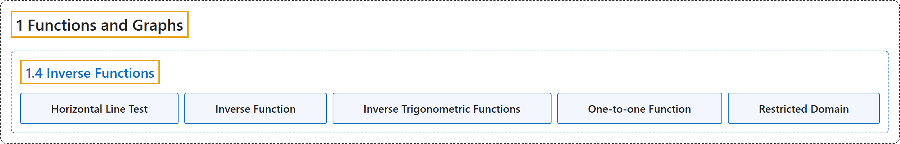

# 1.4 Inverse Functions

## Classification

## Glossary

| Term | Definition | 中文翻译 | Source |
|---|---|---|---|
| **1 Functions and Graphs** 函数与图像 | (No definition) | （无定义） | [Strang & Herman, 2016a, chapter 1](https://openstax.org/books/calculus-volume-1/pages/1-introduction) |
| **1.4 Inverse Functions** 反函数 | (No definition) | （无定义） | [Strang & Herman, 2016a, section 1.4](https://openstax.org/books/calculus-volume-1/pages/1-4-inverse-functions) |
| **Horizontal Line Test** 横线检验 | "a function $f$ is one-to-one if and only if **every horizontal line intersects the graph of** $f,$ at most, once" | 函数 $f$ 是一一的，当且仅当**每条水平线与 $f$ 的图像**至多相交一次 | [Strang & Herman, 2016a, chapter 1 Key Terms](https://openstax.org/books/calculus-volume-1/pages/1-key-terms#fs-id1170572229168) |
| **Inverse Function** 反函数 | "for a function $f,$ **the inverse function** $f^{-1}$ satisfies $f^{-1}(y)=x$ if $f(x)=y$" | 对函数 $f,$ **反函数** $f^{-1}$ 满足：若 $f(x)=y$ 则 $f^{-1}(y)=x$ | [Strang & Herman, 2016a, chapter 1 Key Terms](https://openstax.org/books/calculus-volume-1/pages/1-key-terms#fs-id1170572229190) |
| **Inverse Trigonometric Functions** 反三角函数 | "the inverses of the trigonometric functions are defined on **restricted domains** where they are one-to-one functions" | 三角函数的反函数，定义在使其成为一一函数的**受限定义域**上 | [Strang & Herman, 2016a, chapter 1 Key Terms](https://openstax.org/books/calculus-volume-1/pages/1-key-terms#fs-id1170572482608) |
| **One-to-one Function** 一一函数 | "a function $f$ **is one-to-one** if $f(x_{1})\ne f(x_{2})$ if $x_{1}\ne x_{2}$" | 函数 $f$ **是一一的**，如果 $x_{1}\ne x_{2}$ 时 $f(x_{1})\ne f(x_{2})$ | [Strang & Herman, 2016a, chapter 1 Key Terms](https://openstax.org/books/calculus-volume-1/pages/1-key-terms#fs-id1170572482619) |
| **Restricted Domain** 受限定义域 | "**a subset of the domain** of a function $f$" | 函数 $f$ 的**定义域的一个子集** | [Strang & Herman, 2016a, chapter 1 Key Terms](https://openstax.org/books/calculus-volume-1/pages/1-key-terms#fs-id1170572482683) |

## References

Strang, G., & Herman, E. (2016a). *Calculus volume 1*. OpenStax. Retrieved October 29, 2026, from <https://openstax.org/details/books/calculus-volume-1>
