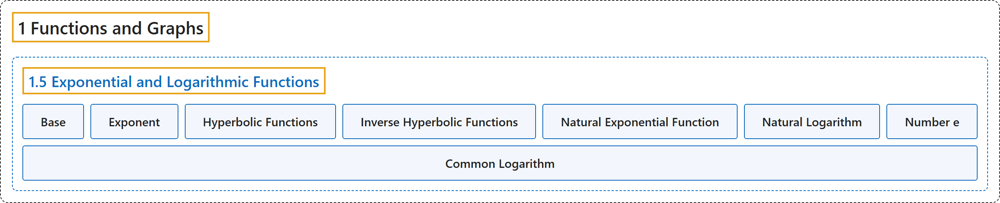

# 1.5 Exponential and Logarithmic Functions

## Classification

## Glossary

| Term | Definition | 中文翻译 | Source |
|---|---|---|---|
| **1 Functions and Graphs** 函数与图像 | (No definition) | （无定义） | [Strang & Herman, 2016a, chapter 1](https://openstax.org/books/calculus-volume-1/pages/1-introduction) |
| **1.5 Exponential and Logarithmic Functions** 指数函数与对数函数 | (No definition) | （无定义） | [Strang & Herman, 2016a, section 1.5](https://openstax.org/books/calculus-volume-1/pages/1-5-exponential-and-logarithmic-functions) |
| **Base** 底 | "**the number** $b$ in the exponential function $f(x)=b^{x}$ and the logarithmic function $f(x)=\log_{b}x$" | 指数函数 $f(x)=b^{x}$ 和对数函数 $f(x)=\log_{b}x$ 中的**数** $b$ | [Strang & Herman, 2016a, chapter 1 Key Terms](https://openstax.org/books/calculus-volume-1/pages/1-key-terms#fs-id1170572544592) |
| **Exponent** 指数 | "**the value** $x$ in the expression $b^{x}$" | 表达式 $b^{x}$ 中的**值** $x$ | [Strang & Herman, 2016a, chapter 1 Key Terms](https://openstax.org/books/calculus-volume-1/pages/1-key-terms#fs-id1170572544649) |
| **Hyperbolic Functions** 双曲函数 | "the functions denoted $\sinh ,\cosh ,\tanh ,\operatorname{csch},\operatorname{sech},$ and $\coth ,$ which involve **certain combinations of** $e^{x}$ and $e^{-x}$" | 记作 $\sinh ,\cosh ,\tanh ,\operatorname{csch},\operatorname{sech},$ 和 $\coth ,$ 的函数，它们涉及 $e^{x}$ 与 $e^{-x}$ 的**某些组合** | [Strang & Herman, 2016a, chapter 1 Key Terms](https://openstax.org/books/calculus-volume-1/pages/1-key-terms#fs-id1170572544670) |
| **Inverse Hyperbolic Functions** 反双曲函数 | "**the inverses of the hyperbolic functions** where $\cosh$ and $\operatorname{sech}$ are restricted to the domain $[0,\infty );$ each of these functions can be expressed in terms of a composition of **the natural logarithm function and an algebraic function**" | **双曲函数的反函数**，其中 $\cosh$ 和 $\operatorname{sech}$ 限制在定义域 $[0,\infty );$ 上；每个这样的函数都可以表示为**自然对数函数与一个代数函数**的复合 | [Strang & Herman, 2016a, chapter 1 Key Terms](https://openstax.org/books/calculus-volume-1/pages/1-key-terms#fs-id1170572294452) |
| **Natural Exponential Function** 自然指数函数 | "**the function** $f(x)=e^{x}$" | **函数** $f(x)=e^{x}$ | [Strang & Herman, 2016a, chapter 1 Key Terms](https://openstax.org/books/calculus-volume-1/pages/1-key-terms#fs-id1170572294493) |
| **Natural Logarithm** 自然对数 | "**the function** $\ln \,x=\log_{e}x$" | **函数** $\ln \,x=\log_{e}x$ | [Strang & Herman, 2016a, chapter 1 Key Terms](https://openstax.org/books/calculus-volume-1/pages/1-key-terms#fs-id1170572294522) |
| **Number e** 数 e | "as $m$ gets larger, the quantity $(1+(1/m))^{m}$ **gets closer to some real number**; we define that real number to be $e;$ the value of $e$ is approximately $2.718282$" | 随着 $m$ 变大，量 $(1+(1/m))^{m}$ **越来越接近某个实数**；我们把这个实数定义为 $e;$ $e$ 的值约为 $2.718282$ | [Strang & Herman, 2016a, chapter 1 Key Terms](https://openstax.org/books/calculus-volume-1/pages/1-key-terms#fs-id1170572294549) |
| **Common Logarithm** 常用对数 | "When evaluating a logarithmic function with a calculator, you may have noticed that the only options are $\log_{10}$ or log, called **the common logarithm**, or ln, which is the natural logarithm." | 用计算器计算对数函数时，你可能注意到只有 $\log_{10}$ 或 log（称为**常用对数**），或 ln（即自然对数）这几个选项。 | [Strang & Herman, 2016a, section 1.5](https://openstax.org/books/calculus-volume-1/pages/1-5-exponential-and-logarithmic-functions#term-00008) |

## References

Strang, G., & Herman, E. (2016a). *Calculus volume 1*. OpenStax. Retrieved October 29, 2026, from <https://openstax.org/details/books/calculus-volume-1>
