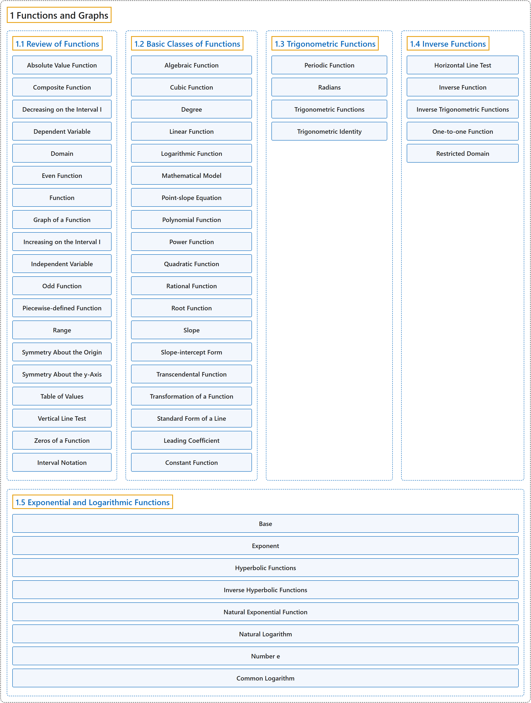

# 1 Functions and Graphs

## Classification

## Glossary

| Term | Definition | 中文翻译 | Source |
|---|---|---|---|
| **1 Functions and Graphs** 函数与图像 | (No definition) | （无定义） | [Strang & Herman, 2016a, chapter 1](https://openstax.org/books/calculus-volume-1/pages/1-introduction) |
| **[1.1 Review of Functions](1-1-review-of-functions.md)** 函数复习 | (No definition) | （无定义） | [Strang & Herman, 2016a, section 1.1](https://openstax.org/books/calculus-volume-1/pages/1-1-review-of-functions) |
| **[1.2 Basic Classes of Functions](1-2-basic-classes-of-functions.md)** 函数的基本类型 | (No definition) | （无定义） | [Strang & Herman, 2016a, section 1.2](https://openstax.org/books/calculus-volume-1/pages/1-2-basic-classes-of-functions) |
| **[1.3 Trigonometric Functions](1-3-trigonometric-functions.md)** 三角函数 | (No definition) | （无定义） | [Strang & Herman, 2016a, section 1.3](https://openstax.org/books/calculus-volume-1/pages/1-3-trigonometric-functions) |
| **[1.4 Inverse Functions](1-4-inverse-functions.md)** 反函数 | (No definition) | （无定义） | [Strang & Herman, 2016a, section 1.4](https://openstax.org/books/calculus-volume-1/pages/1-4-inverse-functions) |
| **[1.5 Exponential and Logarithmic Functions](1-5-exponential-and-logarithmic-functions.md)** 指数函数与对数函数 | (No definition) | （无定义） | [Strang & Herman, 2016a, section 1.5](https://openstax.org/books/calculus-volume-1/pages/1-5-exponential-and-logarithmic-functions) |

## References

Strang, G., & Herman, E. (2016a). *Calculus volume 1*. OpenStax. Retrieved October 29, 2026, from <https://openstax.org/details/books/calculus-volume-1>
