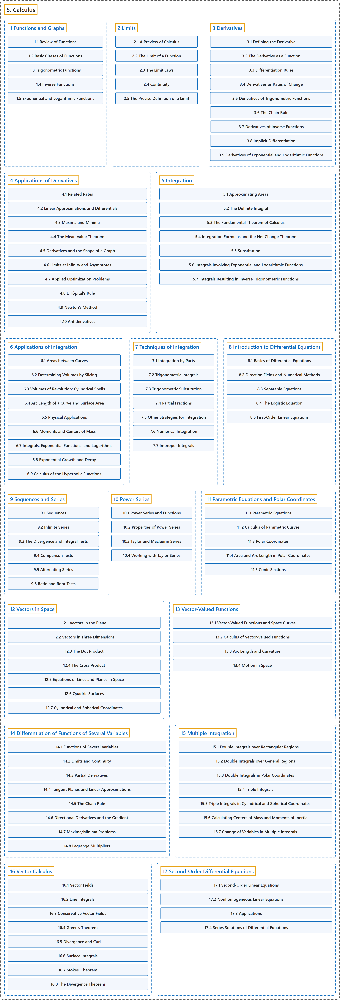

# 5. Calculus

## Classification

## Glossary

| Term | Definition | 中文翻译 | Source |
|---|---|---|---|
| **Calculus** 微积分 | "'The' calculus, more properly called analysis (or real analysis or, in older literature, infinitesimal analysis), is the branch of mathematics studying the **rate of change of quantities** (which can be interpreted as slopes of curves) and the **length, area, and volume of objects**." | 这门微积分更恰当的名称是分析（或实分析，旧文献中称无穷小分析），是研究**量的变化率**（可解释为曲线的斜率）以及**物体的长度、面积和体积**的数学分支。 | [Weisstein, n.d., "Calculus" entry, para. 2](https://mathworld.wolfram.com/Calculus.html#:~:text=is%20the%20branch%20of%20mathematics%20studying%20the%20rate%20of%20change) |
| **[1 Functions and Graphs](functions-and-graphs/index.md)** 函数与图像 | (No definition) | （无定义） | [Strang & Herman, 2016a, chapter 1](https://openstax.org/books/calculus-volume-1/pages/1-introduction) |
| **[2 Limits](limits/index.md)** 极限 | (No definition) | （无定义） | [Strang & Herman, 2016a, chapter 2](https://openstax.org/books/calculus-volume-1/pages/2-introduction) |
| **[3 Derivatives](derivatives/index.md)** 导数 | (No definition) | （无定义） | [Strang & Herman, 2016a, chapter 3](https://openstax.org/books/calculus-volume-1/pages/3-introduction) |
| **[4 Applications of Derivatives](applications-of-derivatives/index.md)** 导数的应用 | (No definition) | （无定义） | [Strang & Herman, 2016a, chapter 4](https://openstax.org/books/calculus-volume-1/pages/4-introduction) |
| **[5 Integration](integration/index.md)** 积分 | (No definition) | （无定义） | [Strang & Herman, 2016a, chapter 5](https://openstax.org/books/calculus-volume-1/pages/5-introduction) |
| **[6 Applications of Integration](applications-of-integration/index.md)** 积分的应用 | (No definition) | （无定义） | [Strang & Herman, 2016a, chapter 6](https://openstax.org/books/calculus-volume-1/pages/6-introduction) |
| **[7 Techniques of Integration](techniques-of-integration/index.md)** 积分技巧 | (No definition) | （无定义） | [Strang & Herman, 2016b, chapter 3](https://openstax.org/books/calculus-volume-2/pages/3-introduction) |
| **[8 Introduction to Differential Equations](introduction-to-differential-equations/index.md)** 微分方程初步 | (No definition) | （无定义） | [Strang & Herman, 2016b, chapter 4](https://openstax.org/books/calculus-volume-2/pages/4-introduction) |
| **[9 Sequences and Series](sequences-and-series/index.md)** 数列与级数 | (No definition) | （无定义） | [Strang & Herman, 2016b, chapter 5](https://openstax.org/books/calculus-volume-2/pages/5-introduction) |
| **[10 Power Series](power-series/index.md)** 幂级数 | (No definition) | （无定义） | [Strang & Herman, 2016b, chapter 6](https://openstax.org/books/calculus-volume-2/pages/6-introduction) |
| **[11 Parametric Equations and Polar Coordinates](parametric-equations-and-polar-coordinates/index.md)** 参数方程与极坐标 | (No definition) | （无定义） | [Strang & Herman, 2016b, chapter 7](https://openstax.org/books/calculus-volume-2/pages/7-introduction) |
| **[12 Vectors in Space](vectors-in-space/index.md)** 空间向量 | (No definition) | （无定义） | [Strang & Herman, 2016c, chapter 2](https://openstax.org/books/calculus-volume-3/pages/2-introduction) |
| **[13 Vector-Valued Functions](vector-valued-functions/index.md)** 向量值函数 | (No definition) | （无定义） | [Strang & Herman, 2016c, chapter 3](https://openstax.org/books/calculus-volume-3/pages/3-introduction) |
| **[14 Differentiation of Functions of Several Variables](differentiation-of-functions-of-several-variables/index.md)** 多元函数微分学 | (No definition) | （无定义） | [Strang & Herman, 2016c, chapter 4](https://openstax.org/books/calculus-volume-3/pages/4-introduction) |
| **[15 Multiple Integration](multiple-integration/index.md)** 重积分 | (No definition) | （无定义） | [Strang & Herman, 2016c, chapter 5](https://openstax.org/books/calculus-volume-3/pages/5-introduction) |
| **[16 Vector Calculus](vector-calculus/index.md)** 向量微积分 | (No definition) | （无定义） | [Strang & Herman, 2016c, chapter 6](https://openstax.org/books/calculus-volume-3/pages/6-introduction) |
| **[17 Second-Order Differential Equations](second-order-differential-equations/index.md)** 二阶微分方程 | (No definition) | （无定义） | [Strang & Herman, 2016c, chapter 7](https://openstax.org/books/calculus-volume-3/pages/7-introduction) |

## References

Weisstein, E. W. (n.d.). *Calculus*. MathWorld: A Wolfram Resource. Retrieved October 27, 2026, from <https://mathworld.wolfram.com/Calculus.html>

Strang, G., & Herman, E. (2016a). *Calculus volume 1*. OpenStax. Retrieved October 29, 2026, from <https://openstax.org/details/books/calculus-volume-1>

Strang, G., & Herman, E. (2016b). *Calculus volume 2*. OpenStax. Retrieved October 29, 2026, from <https://openstax.org/details/books/calculus-volume-2>

Strang, G., & Herman, E. (2016c). *Calculus volume 3*. OpenStax. Retrieved October 29, 2026, from <https://openstax.org/details/books/calculus-volume-3>
