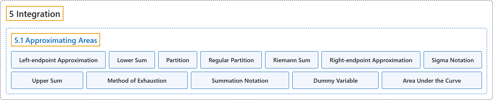

# 5.1 Approximating Areas

## Classification

## Glossary

| Term | Definition | 中文翻译 | Source |
|---|---|---|---|
| **5 Integration** 积分 | (No definition) | （无定义） | [Strang & Herman, 2016a, chapter 5](https://openstax.org/books/calculus-volume-1/pages/5-introduction) |
| **5.1 Approximating Areas** 面积的近似 | (No definition) | （无定义） | [Strang & Herman, 2016a, section 5.1](https://openstax.org/books/calculus-volume-1/pages/5-1-approximating-areas) |
| **Left-endpoint Approximation** 左端点近似 | "an approximation of the area under a curve computed by using **the left endpoint of each subinterval** to calculate the height of the vertical sides of each rectangle" | 曲线下面积的一种近似，用**每个子区间的左端点**计算每个矩形竖边的高 | [Strang & Herman, 2016a, chapter 5 Key Terms](https://openstax.org/books/calculus-volume-1/pages/5-key-terms#fs-id1170571577527) |
| **Lower Sum** 下和 | "a sum obtained by using **the minimum value** of $f(x)$ on each subinterval" | 在每个子区间上用 $f(x)$ 的**最小值**得到的和 | [Strang & Herman, 2016a, chapter 5 Key Terms](https://openstax.org/books/calculus-volume-1/pages/5-key-terms#fs-id1170571577538) |
| **Partition** 分划 | "a set of points that **divides an interval into subintervals**" | **把区间分成子区间**的一组点 | [Strang & Herman, 2016a, chapter 5 Key Terms](https://openstax.org/books/calculus-volume-1/pages/5-key-terms#fs-id1170571577561) |
| **Regular Partition** 等距分划 | "a partition in which the subintervals all have **the same width**" | 各子区间都有**相同宽度**的分划 | [Strang & Herman, 2016a, chapter 5 Key Terms](https://openstax.org/books/calculus-volume-1/pages/5-key-terms#fs-id1170571577570) |
| **Riemann Sum** 黎曼和 | "**an estimate of the area under the curve** of the form $A\approx \sum_{i=1}^{n}f(x_{i}^{*})\Delta x$" | **曲线下面积的一种估计**，形如 $A\approx \sum_{i=1}^{n}f(x_{i}^{*})\Delta x$ | [Strang & Herman, 2016a, chapter 5 Key Terms](https://openstax.org/books/calculus-volume-1/pages/5-key-terms#fs-id1170571577580) |
| **Right-endpoint Approximation** 右端点近似 | "the right-endpoint approximation is an approximation of the area of the rectangles under a curve using **the right endpoint of each subinterval** to construct the vertical sides of each rectangle" | 右端点近似是曲线下矩形面积的一种近似，用**每个子区间的右端点**构造每个矩形的竖边 | [Strang & Herman, 2016a, chapter 5 Key Terms](https://openstax.org/books/calculus-volume-1/pages/5-key-terms#fs-id1170572373515) |
| **Sigma Notation** Σ 记号 | "(also, summation notation) the Greek letter sigma (Σ) **indicates addition of the values**; the values of the index above and below the sigma indicate where to begin the summation and where to end it" | （也称求和记号）希腊字母 sigma（Σ）**表示把各值相加**；sigma 上下方的指标值表示从哪里开始求和、到哪里结束 | [Strang & Herman, 2016a, chapter 5 Key Terms](https://openstax.org/books/calculus-volume-1/pages/5-key-terms#fs-id1170572373527) |
| **Upper Sum** 上和 | "a sum obtained by using **the maximum value** of $f(x)$ on each subinterval" | 在每个子区间上用 $f(x)$ 的**最大值**得到的和 | [Strang & Herman, 2016a, chapter 5 Key Terms](https://openstax.org/books/calculus-volume-1/pages/5-key-terms#fs-id1170572373545) |
| **Method of Exhaustion** 穷竭法 | "He used a process that has come to be known as **the method of exhaustion**, which used smaller and smaller shapes, the areas of which could be calculated exactly, to fill an irregular region and thereby obtain closer and closer approximations to the total area." | 他使用了一种后来被称为**穷竭法**的方法，用越来越小、面积可以精确计算的图形填满一个不规则区域，从而得到越来越接近总面积的近似。 | [Strang & Herman, 2016a, section 5.1](https://openstax.org/books/calculus-volume-1/pages/5-1-approximating-areas#term-00002) |
| **Summation Notation** 求和记号 | "To make it easier to write down these lengthy sums, we look at some new notation here, called sigma notation (also known as **summation notation**)." | 为了更容易写出这些冗长的和，我们在这里看一种新记号，称为 sigma 记号（也称**求和记号**）。 | [Strang & Herman, 2016a, section 5.1](https://openstax.org/books/calculus-volume-1/pages/5-1-approximating-areas#term-00004) |
| **Dummy Variable** 哑变量 | "The index is therefore called **a dummy variable**." | 因此这个指标称为**哑变量**。 | [Strang & Herman, 2016a, section 5.1](https://openstax.org/books/calculus-volume-1/pages/5-1-approximating-areas#term-00006) |
| **Area Under the Curve** 曲线下面积 | "Then, **the area under the curve** $y=f(x)$ on $[a,b]$ is given by" | 于是，**曲线下面积** $y=f(x)$ 在 $[a,b]$ 上由下式给出 | [Strang & Herman, 2016a, section 5.1](https://openstax.org/books/calculus-volume-1/pages/5-1-approximating-areas#term-00013) |

## References

Strang, G., & Herman, E. (2016a). *Calculus volume 1*. OpenStax. Retrieved October 29, 2026, from <https://openstax.org/details/books/calculus-volume-1>
