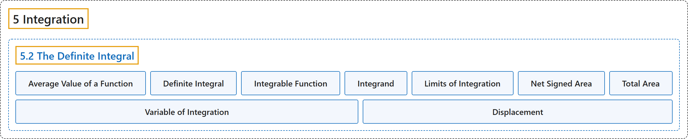

# 5.2 The Definite Integral

## Classification

## Glossary

| Term | Definition | 中文翻译 | Source |
|---|---|---|---|
| **5 Integration** 积分 | (No definition) | （无定义） | [Strang & Herman, 2016a, chapter 5](https://openstax.org/books/calculus-volume-1/pages/5-introduction) |
| **5.2 The Definite Integral** 定积分 | (No definition) | （无定义） | [Strang & Herman, 2016a, section 5.2](https://openstax.org/books/calculus-volume-1/pages/5-2-the-definite-integral) |
| **Average Value of a Function** 函数的平均值 | "(or fave) the average value of a function on an interval can be found by calculating the definite integral of the function and **dividing that value by the length of the interval**" | （或 fave）函数在区间上的平均值可以这样求：计算函数的定积分，再**把这个值除以区间长度** | [Strang & Herman, 2016a, chapter 5 Key Terms](https://openstax.org/books/calculus-volume-1/pages/5-key-terms#fs-id1170572398858) |
| **Definite Integral** 定积分 | "**a primary operation of calculus**; the area between the curve and the x-axis over a given interval is a definite integral" | **微积分的一种基本运算**；给定区间上曲线与 x 轴之间的面积就是定积分 | [Strang & Herman, 2016a, chapter 5 Key Terms](https://openstax.org/books/calculus-volume-1/pages/5-key-terms#fs-id1170572398877) |
| **Integrable Function** 可积函数 | "a function is integrable if **the limit defining the integral exists**; in other words, if the limit of the Riemann sums as n goes to infinity exists" | 如果**定义积分的极限存在**，函数就是可积的；换句话说，就是 n 趋于无穷时黎曼和的极限存在 | [Strang & Herman, 2016a, chapter 5 Key Terms](https://openstax.org/books/calculus-volume-1/pages/5-key-terms#fs-id1170572398892) |
| **Integrand** 被积函数 | "**the function to the right of the integration symbol**; the integrand includes the function being integrated" | **积分号右边的函数**；被积函数包括被积分的函数 | [Strang & Herman, 2016a, chapter 5 Key Terms](https://openstax.org/books/calculus-volume-1/pages/5-key-terms#fs-id1170572398909) |
| **Limits of Integration** 积分限 | "these values appear near the top and bottom of the integral sign and **define the interval over which the function should be integrated**" | 这些值出现在积分号的顶部和底部附近，**规定函数在哪个区间上积分** | [Strang & Herman, 2016a, chapter 5 Key Terms](https://openstax.org/books/calculus-volume-1/pages/5-key-terms#fs-id1170572398919) |
| **Net Signed Area** 有向面积 | "the area between a function and the x-axis such that **the area below the x-axis is subtracted from the area above the x-axis**; the result is the same as the definite integral of the function" | 函数与 x 轴之间的面积，其中**从 x 轴上方的面积中减去 x 轴下方的面积**；结果与函数的定积分相同 | [Strang & Herman, 2016a, chapter 5 Key Terms](https://openstax.org/books/calculus-volume-1/pages/5-key-terms#fs-id1170572398930) |
| **Total Area** 总面积 | "total area between a function and the x-axis is calculated by **adding the area above the x-axis and the area below the x-axis**; the result is the same as the definite integral of the absolute value of the function" | 函数与 x 轴之间的总面积，由**x 轴上方的面积与 x 轴下方的面积相加**算出；结果与函数绝对值的定积分相同 | [Strang & Herman, 2016a, chapter 5 Key Terms](https://openstax.org/books/calculus-volume-1/pages/5-key-terms#fs-id1170572398956) |
| **Variable of Integration** 积分变量 | "indicates **which variable you are integrating with respect to**; if it is x, then the function in the integrand is followed by dx" | 表示**对哪个变量积分**；若为 x，则被积函数后跟 dx | [Strang & Herman, 2016a, chapter 5 Key Terms](https://openstax.org/books/calculus-volume-1/pages/5-key-terms#fs-id1170571613095) |
| **Displacement** 位移 | "One application of the definite integral is **finding displacement** when given a velocity function." | 定积分的一个应用是在给定速度函数时**求位移**。 | [Strang & Herman, 2016a, section 5.2](https://openstax.org/books/calculus-volume-1/pages/5-2-the-definite-integral#term-00009) |

## References

Strang, G., & Herman, E. (2016a). *Calculus volume 1*. OpenStax. Retrieved October 29, 2026, from <https://openstax.org/details/books/calculus-volume-1>
