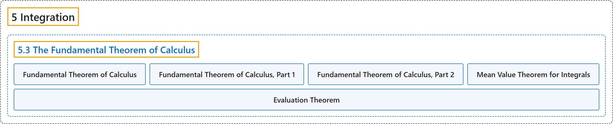

# 5.3 The Fundamental Theorem of Calculus

## Classification

## Glossary

| Term | Definition | 中文翻译 | Source |
|---|---|---|---|
| **5 Integration** 积分 | (No definition) | （无定义） | [Strang & Herman, 2016a, chapter 5](https://openstax.org/books/calculus-volume-1/pages/5-introduction) |
| **5.3 The Fundamental Theorem of Calculus** 微积分基本定理 | (No definition) | （无定义） | [Strang & Herman, 2016a, section 5.3](https://openstax.org/books/calculus-volume-1/pages/5-3-the-fundamental-theorem-of-calculus) |
| **Fundamental Theorem of Calculus** 微积分基本定理 | "the theorem, central to the entire development of calculus, that establishes **the relationship between differentiation and integration**" | 贯穿整个微积分发展的核心定理，它建立了**微分与积分之间的关系** | [Strang & Herman, 2016a, chapter 5 Key Terms](https://openstax.org/books/calculus-volume-1/pages/5-key-terms#fs-id1170572379108) |
| **Fundamental Theorem of Calculus, Part 1** 微积分基本定理第一部分 | "uses a definite integral **to define an antiderivative** of a function" | 用定积分**来定义函数的原函数** | [Strang & Herman, 2016a, chapter 5 Key Terms](https://openstax.org/books/calculus-volume-1/pages/5-key-terms#fs-id1170572379119) |
| **Fundamental Theorem of Calculus, Part 2** 微积分基本定理第二部分 | "(also, evaluation theorem) we can evaluate a definite integral by **evaluating the antiderivative of the integrand at the endpoints of the interval and subtracting**" | （也称求值定理）我们可以通过**在区间端点处计算被积函数的原函数再相减**来求定积分 | [Strang & Herman, 2016a, chapter 5 Key Terms](https://openstax.org/books/calculus-volume-1/pages/5-key-terms#fs-id1170572379128) |
| **Mean Value Theorem for Integrals** 积分中值定理 | "guarantees that a point c exists such that $f(c)$ is **equal to the average value of the function**" | 保证存在一点 c，使得 $f(c)$ **等于函数的平均值** | [Strang & Herman, 2016a, chapter 5 Key Terms](https://openstax.org/books/calculus-volume-1/pages/5-key-terms#fs-id1170572379144) |
| **Evaluation Theorem** 求值定理 | "The Fundamental Theorem of Calculus, Part 2 (also known as **the evaluation theorem**) states that if we can find an antiderivative for the integrand, then we can evaluate the definite integral by evaluating the antiderivative at the endpoints of the interval and subtracting." | 微积分基本定理第二部分（也称**求值定理**）指出，如果能找到被积函数的原函数，就可以在区间端点处计算该原函数再相减，从而求出定积分。 | [Strang & Herman, 2016a, section 5.3](https://openstax.org/books/calculus-volume-1/pages/5-3-the-fundamental-theorem-of-calculus#term-00006) |

## References

Strang, G., & Herman, E. (2016a). *Calculus volume 1*. OpenStax. Retrieved October 29, 2026, from <https://openstax.org/details/books/calculus-volume-1>
