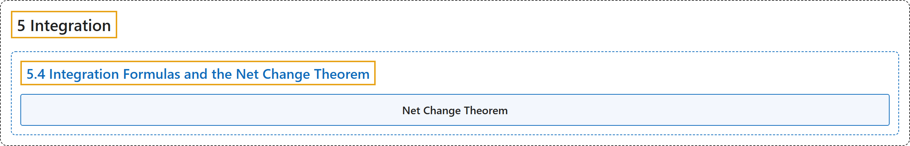

# 5.4 Integration Formulas and the Net Change Theorem

## Classification

## Glossary

| Term | Definition | 中文翻译 | Source |
|---|---|---|---|
| **5 Integration** 积分 | (No definition) | （无定义） | [Strang & Herman, 2016a, chapter 5](https://openstax.org/books/calculus-volume-1/pages/5-introduction) |
| **5.4 Integration Formulas and the Net Change Theorem** 积分公式与净变化定理 | (No definition) | （无定义） | [Strang & Herman, 2016a, section 5.4](https://openstax.org/books/calculus-volume-1/pages/5-4-integration-formulas-and-the-net-change-theorem) |
| **Net Change Theorem** 净变化定理 | "if we know the rate of change of a quantity, the net change theorem says the future quantity is equal to **the initial quantity plus the integral of the rate of change** of the quantity" | 如果知道某个量的变化率，净变化定理表明未来的量等于**初始量加上该量变化率的积分** | [Strang & Herman, 2016a, chapter 5 Key Terms](https://openstax.org/books/calculus-volume-1/pages/5-key-terms#fs-id1170572480464) |

## References

Strang, G., & Herman, E. (2016a). *Calculus volume 1*. OpenStax. Retrieved October 29, 2026, from <https://openstax.org/details/books/calculus-volume-1>
