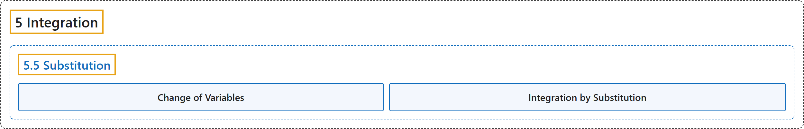

# 5.5 Substitution

## Classification

## Glossary

| Term | Definition | 中文翻译 | Source |
|---|---|---|---|
| **5 Integration** 积分 | (No definition) | （无定义） | [Strang & Herman, 2016a, chapter 5](https://openstax.org/books/calculus-volume-1/pages/5-introduction) |
| **5.5 Substitution** 换元法 | (No definition) | （无定义） | [Strang & Herman, 2016a, section 5.5](https://openstax.org/books/calculus-volume-1/pages/5-5-substitution) |
| **Change of Variables** 换元 | "**the substitution of a variable**, such as u, for an expression in the integrand" | 对被积函数中的表达式**用一个变量（如 u）替换** | [Strang & Herman, 2016a, chapter 5 Key Terms](https://openstax.org/books/calculus-volume-1/pages/5-key-terms#fs-id1170573497269) |
| **Integration by Substitution** 换元积分法 | "a technique for integration that allows integration of functions that are **the result of a chain-rule derivative**" | 一种积分方法，可以对由**链式法则求导得到的**函数进行积分 | [Strang & Herman, 2016a, chapter 5 Key Terms](https://openstax.org/books/calculus-volume-1/pages/5-key-terms#fs-id1170573497284) |

## References

Strang, G., & Herman, E. (2016a). *Calculus volume 1*. OpenStax. Retrieved October 29, 2026, from <https://openstax.org/details/books/calculus-volume-1>
