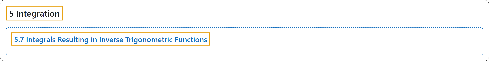

# 5.7 Integrals Resulting in Inverse Trigonometric Functions

## Classification

## Glossary

| Term | Definition | 中文翻译 | Source |
|---|---|---|---|
| **5 Integration** 积分 | (No definition) | （无定义） | [Strang & Herman, 2016a, chapter 5](https://openstax.org/books/calculus-volume-1/pages/5-introduction) |
| **5.7 Integrals Resulting in Inverse Trigonometric Functions** 结果为反三角函数的积分 | (No definition) | （无定义） | [Strang & Herman, 2016a, section 5.7](https://openstax.org/books/calculus-volume-1/pages/5-7-integrals-resulting-in-inverse-trigonometric-functions) |

## References

Strang, G., & Herman, E. (2016a). *Calculus volume 1*. OpenStax. Retrieved October 29, 2026, from <https://openstax.org/details/books/calculus-volume-1>
