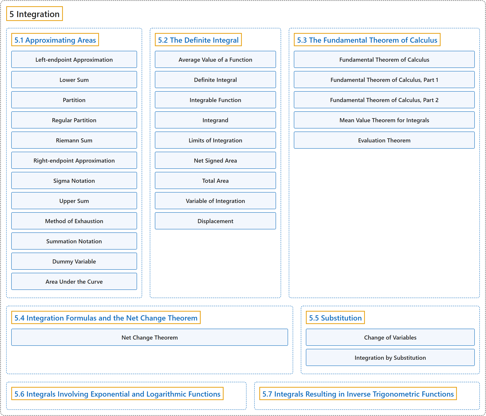

# 5 Integration

## Classification

## Glossary

| Term | Definition | 中文翻译 | Source |
|---|---|---|---|
| **5 Integration** 积分 | (No definition) | （无定义） | [Strang & Herman, 2016a, chapter 5](https://openstax.org/books/calculus-volume-1/pages/5-introduction) |
| **[5.1 Approximating Areas](5-1-approximating-areas.md)** 面积的近似 | (No definition) | （无定义） | [Strang & Herman, 2016a, section 5.1](https://openstax.org/books/calculus-volume-1/pages/5-1-approximating-areas) |
| **[5.2 The Definite Integral](5-2-the-definite-integral.md)** 定积分 | (No definition) | （无定义） | [Strang & Herman, 2016a, section 5.2](https://openstax.org/books/calculus-volume-1/pages/5-2-the-definite-integral) |
| **[5.3 The Fundamental Theorem of Calculus](5-3-the-fundamental-theorem-of-calculus.md)** 微积分基本定理 | (No definition) | （无定义） | [Strang & Herman, 2016a, section 5.3](https://openstax.org/books/calculus-volume-1/pages/5-3-the-fundamental-theorem-of-calculus) |
| **[5.4 Integration Formulas and the Net Change Theorem](5-4-integration-formulas-and-the-net-change-theorem.md)** 积分公式与净变化定理 | (No definition) | （无定义） | [Strang & Herman, 2016a, section 5.4](https://openstax.org/books/calculus-volume-1/pages/5-4-integration-formulas-and-the-net-change-theorem) |
| **[5.5 Substitution](5-5-substitution.md)** 换元法 | (No definition) | （无定义） | [Strang & Herman, 2016a, section 5.5](https://openstax.org/books/calculus-volume-1/pages/5-5-substitution) |
| **[5.6 Integrals Involving Exponential and Logarithmic Functions](5-6-integrals-involving-exponential-and-logarithmic-functions.md)** 含指数函数与对数函数的积分 | (No definition) | （无定义） | [Strang & Herman, 2016a, section 5.6](https://openstax.org/books/calculus-volume-1/pages/5-6-integrals-involving-exponential-and-logarithmic-functions) |
| **[5.7 Integrals Resulting in Inverse Trigonometric Functions](5-7-integrals-resulting-in-inverse-trigonometric-functions.md)** 结果为反三角函数的积分 | (No definition) | （无定义） | [Strang & Herman, 2016a, section 5.7](https://openstax.org/books/calculus-volume-1/pages/5-7-integrals-resulting-in-inverse-trigonometric-functions) |

## References

Strang, G., & Herman, E. (2016a). *Calculus volume 1*. OpenStax. Retrieved October 29, 2026, from <https://openstax.org/details/books/calculus-volume-1>
