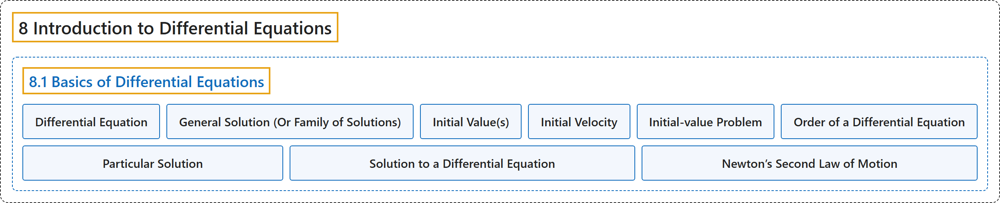

# 8.1 Basics of Differential Equations

## Classification

## Glossary

| Term | Definition | 中文翻译 | Source |
|---|---|---|---|
| **8 Introduction to Differential Equations** 微分方程初步 | (No definition) | （无定义） | [Strang & Herman, 2016b, chapter 4](https://openstax.org/books/calculus-volume-2/pages/4-introduction) |
| **8.1 Basics of Differential Equations** 微分方程基础 | (No definition) | （无定义） | [Strang & Herman, 2016b, section 4.1](https://openstax.org/books/calculus-volume-2/pages/4-1-basics-of-differential-equations) |
| **Differential Equation** 微分方程 | "an equation involving a function $y=y(x)$ and **one or more of its derivatives**" | 含函数 $y=y(x)$ 及其**一阶或多阶导数**的方程 | [Strang & Herman, 2016b, chapter 4 Key Terms](https://openstax.org/books/calculus-volume-2/pages/4-key-terms#fs-id1170571278839) |
| **General Solution (Or Family of Solutions)** 通解（或解族） | "**the entire set of solutions** to a given differential equation" | 给定微分方程的**全部解的集合** | [Strang & Herman, 2016b, chapter 4 Key Terms](https://openstax.org/books/calculus-volume-2/pages/4-key-terms#fs-id1170571146732) |
| **Initial Value(s)** 初值 | "a value or set of values that a solution of a differential equation satisfies **for a fixed value of the independent variable**" | 微分方程的解**在自变量取某个固定值时**所满足的一个值或一组值 | [Strang & Herman, 2016b, chapter 4 Key Terms](https://openstax.org/books/calculus-volume-2/pages/4-key-terms#fs-id1170571146742) |
| **Initial Velocity** 初速度 | "**the velocity at time** $t=0$" | **时刻 $t=0$ 的速度** | [Strang & Herman, 2016b, chapter 4 Key Terms](https://openstax.org/books/calculus-volume-2/pages/4-key-terms#fs-id1170571146753) |
| **Initial-value Problem** 初值问题 | "a differential equation **together with an initial value or values**" | 微分方程**连同一个或多个初值** | [Strang & Herman, 2016b, chapter 4 Key Terms](https://openstax.org/books/calculus-volume-2/pages/4-key-terms#fs-id1170571146771) |
| **Order of a Differential Equation** 微分方程的阶 | "**the highest order of any derivative** of the unknown function that appears in the equation" | 方程中出现的未知函数的**导数的最高阶数** | [Strang & Herman, 2016b, chapter 4 Key Terms](https://openstax.org/books/calculus-volume-2/pages/4-key-terms#fs-id1170571146780) |
| **Particular Solution** 特解 | "member of a family of solutions to a differential equation that **satisfies a particular initial condition**" | 微分方程解族中**满足某个特定初始条件**的成员 | [Strang & Herman, 2016b, chapter 4 Key Terms](https://openstax.org/books/calculus-volume-2/pages/4-key-terms#fs-id1170571146790) |
| **Solution to a Differential Equation** 微分方程的解 | "a function $y=f(x)$ that **satisfies a given differential equation**" | **满足给定微分方程**的函数 $y=f(x)$ | [Strang & Herman, 2016b, chapter 4 Key Terms](https://openstax.org/books/calculus-volume-2/pages/4-key-terms#fs-id1170571146801) |
| **Newton’s Second Law of Motion** 牛顿第二运动定律 | "Physicists and engineers can use this information, along with **Newton’s second law of motion** (in equation form $F=ma,$ where $F$ represents force, $m$ represents mass, and $a$ represents acceleration), to derive an equation that can be solved." | 物理学家和工程师可以利用这些信息，连同**牛顿第二运动定律**（方程形式为 $F=ma,$ 其中 $F$ 表示力，$m$ 表示质量，$a$ 表示加速度），推出一个可以求解的方程。 | [Strang & Herman, 2016b, section 4.1](https://openstax.org/books/calculus-volume-2/pages/4-1-basics-of-differential-equations#term-00008) |

## References

Strang, G., & Herman, E. (2016b). *Calculus volume 2*. OpenStax. Retrieved October 29, 2026, from <https://openstax.org/details/books/calculus-volume-2>
