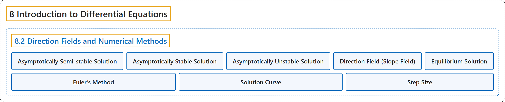

# 8.2 Direction Fields and Numerical Methods

## Classification

## Glossary

| Term | Definition | 中文翻译 | Source |
|---|---|---|---|
| **8 Introduction to Differential Equations** 微分方程初步 | (No definition) | （无定义） | [Strang & Herman, 2016b, chapter 4](https://openstax.org/books/calculus-volume-2/pages/4-introduction) |
| **8.2 Direction Fields and Numerical Methods** 方向场与数值方法 | (No definition) | （无定义） | [Strang & Herman, 2016b, section 4.2](https://openstax.org/books/calculus-volume-2/pages/4-2-direction-fields-and-numerical-methods) |
| **Asymptotically Semi-stable Solution** 渐近半稳定解 | "$y=k$ if it is **neither asymptotically stable nor asymptotically unstable**" | $y=k$，如果它**既不是渐近稳定的，也不是渐近不稳定的** | [Strang & Herman, 2016b, chapter 4 Key Terms](https://openstax.org/books/calculus-volume-2/pages/4-key-terms#fs-id1170571116853) |
| **Asymptotically Stable Solution** 渐近稳定解 | "$y=k$ if there exists $\varepsilon >0$ such that for any value $c\in (k-\varepsilon ,k+\varepsilon )$ the solution to the initial-value problem $y^{'}=f(x,y),\,y(x_{0})=c$ **approaches** $k$ as $x$ approaches infinity" | $y=k$，如果存在 $\varepsilon >0$，使得对任意值 $c\in (k-\varepsilon ,k+\varepsilon )$，初值问题 $y^{'}=f(x,y),\,y(x_{0})=c$ 的解在 $x$ 趋于无穷时**趋近** $k$ | [Strang & Herman, 2016b, chapter 4 Key Terms](https://openstax.org/books/calculus-volume-2/pages/4-key-terms#fs-id1170571116871) |
| **Asymptotically Unstable Solution** 渐近不稳定解 | "$y=k$ if there exists $\varepsilon >0$ such that for any value $c\in (k-\varepsilon ,k+\varepsilon )$ the solution to the initial-value problem $y^{'}=f(x,y),\,y(x_{0})=c$ **never approaches** $k$ as $x$ approaches infinity" | $y=k$，如果存在 $\varepsilon >0$，使得对任意值 $c\in (k-\varepsilon ,k+\varepsilon )$，初值问题 $y^{'}=f(x,y),\,y(x_{0})=c$ 的解在 $x$ 趋于无穷时**永远不趋近** $k$ | [Strang & Herman, 2016b, chapter 4 Key Terms](https://openstax.org/books/calculus-volume-2/pages/4-key-terms#fs-id1170571459118) |
| **Direction Field (Slope Field)** 方向场（斜率场） | "a mathematical object used to **graphically represent solutions to a first-order differential equation**; at each point in a direction field, a line segment appears whose slope is equal to the slope of a solution to the differential equation passing through that point" | 一种数学对象，用来**以图形表示一阶微分方程的解**；在方向场的每一点出现一条线段，其斜率等于经过该点的微分方程解的斜率 | [Strang & Herman, 2016b, chapter 4 Key Terms](https://openstax.org/books/calculus-volume-2/pages/4-key-terms#fs-id1170571051486) |
| **Equilibrium Solution** 平衡解 | "any solution to the differential equation of the form $y=c,$ **where** $c$ is a constant" | 微分方程形如 $y=c,$ 的任一解，**其中** $c$ 是常数 | [Strang & Herman, 2016b, chapter 4 Key Terms](https://openstax.org/books/calculus-volume-2/pages/4-key-terms#fs-id1170571051498) |
| **Euler’s Method** 欧拉法 | "a numerical technique used to **approximate solutions to an initial-value problem**" | 一种数值方法，用来**近似初值问题的解** | [Strang & Herman, 2016b, chapter 4 Key Terms](https://openstax.org/books/calculus-volume-2/pages/4-key-terms#fs-id1170571042387) |
| **Solution Curve** 解曲线 | "a curve graphed in a direction field that corresponds to the solution to the initial-value problem **passing through a given point in the direction field**" | 画在方向场中的一条曲线，对应于**经过方向场中给定点**的初值问题的解 | [Strang & Herman, 2016b, chapter 4 Key Terms](https://openstax.org/books/calculus-volume-2/pages/4-key-terms#fs-id1170571042397) |
| **Step Size** 步长 | "the increment $h$ that **is added to the** $x$ value at each step in Euler’s Method" | 欧拉法每一步中**加到** $x$ 值上的增量 $h$ | [Strang & Herman, 2016b, chapter 4 Key Terms](https://openstax.org/books/calculus-volume-2/pages/4-key-terms#fs-id1170571042408) |

## References

Strang, G., & Herman, E. (2016b). *Calculus volume 2*. OpenStax. Retrieved October 29, 2026, from <https://openstax.org/details/books/calculus-volume-2>
