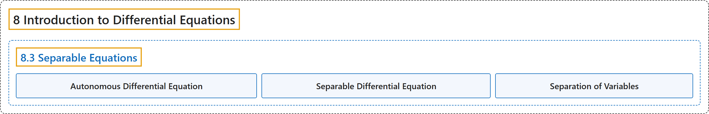

# 8.3 Separable Equations

## Classification

## Glossary

| Term | Definition | 中文翻译 | Source |
|---|---|---|---|
| **8 Introduction to Differential Equations** 微分方程初步 | (No definition) | （无定义） | [Strang & Herman, 2016b, chapter 4](https://openstax.org/books/calculus-volume-2/pages/4-introduction) |
| **8.3 Separable Equations** 可分离方程 | (No definition) | （无定义） | [Strang & Herman, 2016b, section 4.3](https://openstax.org/books/calculus-volume-2/pages/4-3-separable-equations) |
| **Autonomous Differential Equation** 自治微分方程 | "an equation in which the right-hand side is **a function of** $y$ alone" | 右边只是 $y$ **的函数**的方程 | [Strang & Herman, 2016b, chapter 4 Key Terms](https://openstax.org/books/calculus-volume-2/pages/4-key-terms#fs-id1170571243486) |
| **Separable Differential Equation** 可分离微分方程 | "any equation that **can be written in the form** $y'=f(x)g(y)$" | **可以写成 $y'=f(x)g(y)$ 形式**的任一方程 | [Strang & Herman, 2016b, chapter 4 Key Terms](https://openstax.org/books/calculus-volume-2/pages/4-key-terms#fs-id1170571243500) |
| **Separation of Variables** 分离变量法 | "a method used to **solve a separable differential equation**" | 用来**解可分离微分方程**的方法 | [Strang & Herman, 2016b, chapter 4 Key Terms](https://openstax.org/books/calculus-volume-2/pages/4-key-terms#fs-id1170573742138) |

## References

Strang, G., & Herman, E. (2016b). *Calculus volume 2*. OpenStax. Retrieved October 29, 2026, from <https://openstax.org/details/books/calculus-volume-2>
