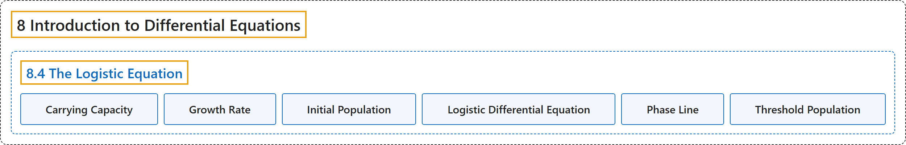

# 8.4 The Logistic Equation

## Classification

## Glossary

| Term | Definition | 中文翻译 | Source |
|---|---|---|---|
| **8 Introduction to Differential Equations** 微分方程初步 | (No definition) | （无定义） | [Strang & Herman, 2016b, chapter 4](https://openstax.org/books/calculus-volume-2/pages/4-introduction) |
| **8.4 The Logistic Equation** 逻辑斯谛方程 | (No definition) | （无定义） | [Strang & Herman, 2016b, section 4.4](https://openstax.org/books/calculus-volume-2/pages/4-4-the-logistic-equation) |
| **Carrying Capacity** 环境容纳量 | "**the maximum population of an organism** that the environment can sustain indefinitely" | 环境能够无限期维持的**某种生物的最大种群数量** | [Strang & Herman, 2016b, chapter 4 Key Terms](https://openstax.org/books/calculus-volume-2/pages/4-key-terms#fs-id1170572147813) |
| **Growth Rate** 增长率 | "the constant $r>0$ **in the exponential growth function** $P(t)=P_{0}e^{rt}$" | **指数增长函数** $P(t)=P_{0}e^{rt}$ 中的常数 $r>0$ | [Strang & Herman, 2016b, chapter 4 Key Terms](https://openstax.org/books/calculus-volume-2/pages/4-key-terms#fs-id1170572351570) |
| **Initial Population** 初始种群 | "**the population at time** $t=0$" | **时刻 $t=0$ 的种群数量** | [Strang & Herman, 2016b, chapter 4 Key Terms](https://openstax.org/books/calculus-volume-2/pages/4-key-terms#fs-id1170572290475) |
| **Logistic Differential Equation** 逻辑斯谛微分方程 | "a differential equation that incorporates the carrying capacity $K$ and growth rate $r$ **into a population model**" | 把环境容纳量 $K$ 和增长率 $r$ 纳入**种群模型**的微分方程 | [Strang & Herman, 2016b, chapter 4 Key Terms](https://openstax.org/books/calculus-volume-2/pages/4-key-terms#fs-id1170571688565) |
| **Phase Line** 相线 | "**a visual representation of the behavior of solutions** to an autonomous differential equation subject to various initial conditions" | 自治微分方程在各种初始条件下**解的行为的可视化表示** | [Strang & Herman, 2016b, chapter 4 Key Terms](https://openstax.org/books/calculus-volume-2/pages/4-key-terms#fs-id1170572379509) |
| **Threshold Population** 阈值种群 | "**the minimum population** that is necessary for a species to survive" | 一个物种存活所必需的**最小种群数量** | [Strang & Herman, 2016b, chapter 4 Key Terms](https://openstax.org/books/calculus-volume-2/pages/4-key-terms#fs-id1170572379519) |

## References

Strang, G., & Herman, E. (2016b). *Calculus volume 2*. OpenStax. Retrieved October 29, 2026, from <https://openstax.org/details/books/calculus-volume-2>
