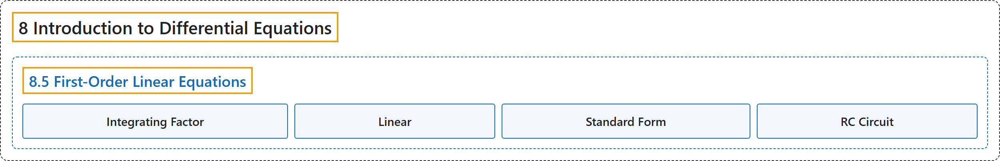

# 8.5 First-Order Linear Equations

## Classification

## Glossary

| Term | Definition | 中文翻译 | Source |
|---|---|---|---|
| **8 Introduction to Differential Equations** 微分方程初步 | (No definition) | （无定义） | [Strang & Herman, 2016b, chapter 4](https://openstax.org/books/calculus-volume-2/pages/4-introduction) |
| **8.5 First-Order Linear Equations** 一阶线性方程 | (No definition) | （无定义） | [Strang & Herman, 2016b, section 4.5](https://openstax.org/books/calculus-volume-2/pages/4-5-first-order-linear-equations) |
| **Integrating Factor** 积分因子 | "any function $f(x)$ that is multiplied on both sides of a differential equation to make the side involving the unknown function **equal to the derivative of a product of two functions**" | 乘到微分方程两边的任一函数 $f(x)$，使含未知函数的一边**等于两个函数之积的导数** | [Strang & Herman, 2016b, chapter 4 Key Terms](https://openstax.org/books/calculus-volume-2/pages/4-key-terms#fs-id1170571813852) |
| **Linear** 线性 | "description of a first-order differential equation that **can be written in the form** $a(x)y^{'}+b(x)y=c(x)$" | 对一阶微分方程的一种描述：它**可以写成 $a(x)y^{'}+b(x)y=c(x)$ 的形式** | [Strang & Herman, 2016b, chapter 4 Key Terms](https://openstax.org/books/calculus-volume-2/pages/4-key-terms#fs-id1170571813876) |
| **Standard Form** 标准形式 | "the form of a first-order linear differential equation **obtained by writing the differential equation in the form** $y'+p(x)y=q(x)$" | 一阶线性微分方程的一种形式，**把微分方程写成 $y'+p(x)y=q(x)$ 的形式所得** | [Strang & Herman, 2016b, chapter 4 Key Terms](https://openstax.org/books/calculus-volume-2/pages/4-key-terms#fs-id1170572386140) |
| **RC Circuit** RC 电路 | "This is referred to as **an RC circuit**." | 这称为 **RC 电路**。 | [Strang & Herman, 2016b, section 4.5](https://openstax.org/books/calculus-volume-2/pages/4-5-first-order-linear-equations#term-00005) |

## References

Strang, G., & Herman, E. (2016b). *Calculus volume 2*. OpenStax. Retrieved October 29, 2026, from <https://openstax.org/details/books/calculus-volume-2>
