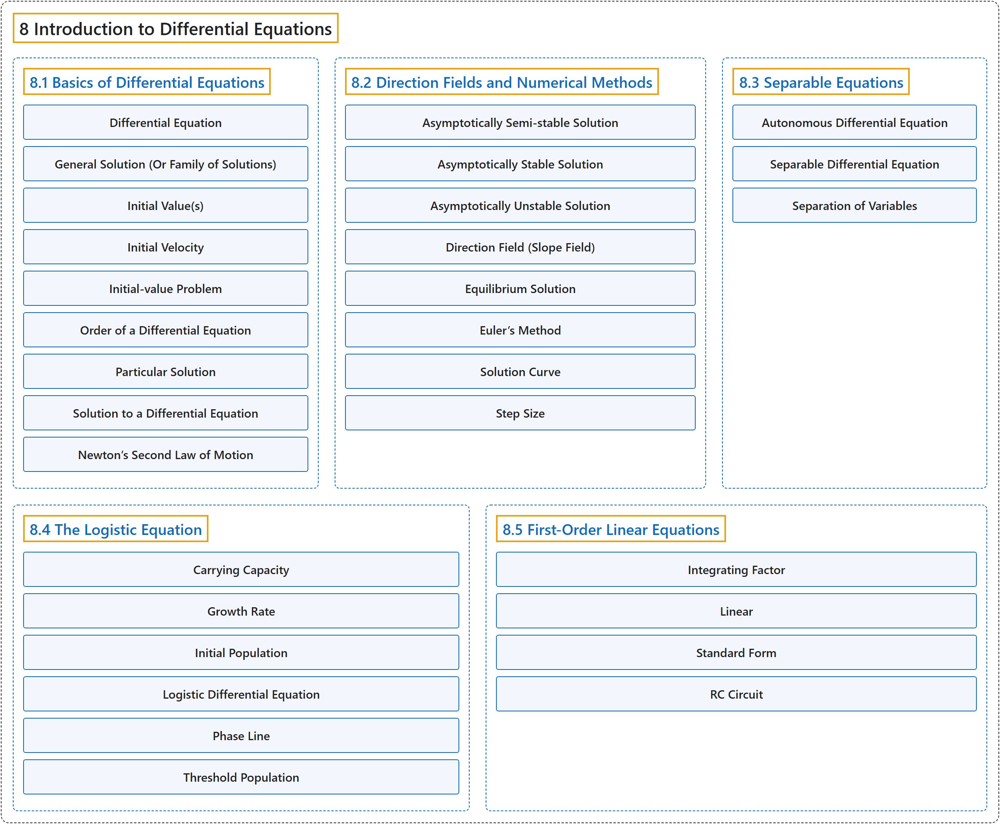

# 8 Introduction to Differential Equations

## Classification

## Glossary

| Term | Definition | 中文翻译 | Source |
|---|---|---|---|
| **8 Introduction to Differential Equations** 微分方程初步 | (No definition) | （无定义） | [Strang & Herman, 2016b, chapter 4](https://openstax.org/books/calculus-volume-2/pages/4-introduction) |
| **[8.1 Basics of Differential Equations](8-1-basics-of-differential-equations.md)** 微分方程基础 | (No definition) | （无定义） | [Strang & Herman, 2016b, section 4.1](https://openstax.org/books/calculus-volume-2/pages/4-1-basics-of-differential-equations) |
| **[8.2 Direction Fields and Numerical Methods](8-2-direction-fields-and-numerical-methods.md)** 方向场与数值方法 | (No definition) | （无定义） | [Strang & Herman, 2016b, section 4.2](https://openstax.org/books/calculus-volume-2/pages/4-2-direction-fields-and-numerical-methods) |
| **[8.3 Separable Equations](8-3-separable-equations.md)** 可分离方程 | (No definition) | （无定义） | [Strang & Herman, 2016b, section 4.3](https://openstax.org/books/calculus-volume-2/pages/4-3-separable-equations) |
| **[8.4 The Logistic Equation](8-4-the-logistic-equation.md)** 逻辑斯谛方程 | (No definition) | （无定义） | [Strang & Herman, 2016b, section 4.4](https://openstax.org/books/calculus-volume-2/pages/4-4-the-logistic-equation) |
| **[8.5 First-Order Linear Equations](8-5-first-order-linear-equations.md)** 一阶线性方程 | (No definition) | （无定义） | [Strang & Herman, 2016b, section 4.5](https://openstax.org/books/calculus-volume-2/pages/4-5-first-order-linear-equations) |

## References

Strang, G., & Herman, E. (2016b). *Calculus volume 2*. OpenStax. Retrieved October 29, 2026, from <https://openstax.org/details/books/calculus-volume-2>
