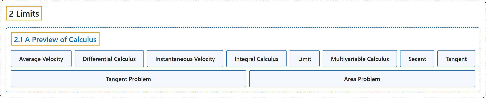

# 2.1 A Preview of Calculus

## Classification

## Glossary

| Term | Definition | 中文翻译 | Source |
|---|---|---|---|
| **2 Limits** 极限 | (No definition) | （无定义） | [Strang & Herman, 2016a, chapter 2](https://openstax.org/books/calculus-volume-1/pages/2-introduction) |
| **2.1 A Preview of Calculus** 微积分预览 | (No definition) | （无定义） | [Strang & Herman, 2016a, section 2.1](https://openstax.org/books/calculus-volume-1/pages/2-1-a-preview-of-calculus) |
| **Average Velocity** 平均速度 | "**the change in an object’s position divided by the length of a time period**; the average velocity of an object over a time interval $[t,a]$ (if $t<a$ or $[a,t]$ if $t>a)$, with a position given by $s(t),$ that is $v_{\text{ave}}=\frac{s(t)-s(a)}{t-a}$" | **物体位置的变化除以时间段的长度**；物体在时间区间 $[t,a]$（若 $t<a$；或 $[a,t]$，若 $t>a)$ 上的平均速度，其位置由 $s(t),$ 给出，即 $v_{\text{ave}}=\frac{s(t)-s(a)}{t-a}$ | [Strang & Herman, 2016a, chapter 2 Key Terms](https://openstax.org/books/calculus-volume-1/pages/2-key-terms#fs-id1170573583169) |
| **Differential Calculus** 微分学 | "the field of calculus concerned with **the study of derivatives and their applications**" | 微积分中关注**导数及其应用的研究**的领域 | [Strang & Herman, 2016a, chapter 2 Key Terms](https://openstax.org/books/calculus-volume-1/pages/2-key-terms#fs-id1170571047938) |
| **Instantaneous Velocity** 瞬时速度 | "The instantaneous velocity of an object with a position function that is given by $s(t)$ is **the value that the average velocities** on intervals of the form $[t,a]$ and $[a,t]$ approach as the values of t move closer to $a,$ provided such a value exists" | 位置函数为 $s(t)$ 的物体的瞬时速度，是当 t 的值越来越接近 $a,$ 时，在形如 $[t,a]$ 和 $[a,t]$ 的区间上**平均速度所趋近的值**，前提是这样的值存在 | [Strang & Herman, 2016a, chapter 2 Key Terms](https://openstax.org/books/calculus-volume-1/pages/2-key-terms#fs-id1170571100400) |
| **Integral Calculus** 积分学 | "**the study of integrals and their applications**" | **积分及其应用的研究** | [Strang & Herman, 2016a, chapter 2 Key Terms](https://openstax.org/books/calculus-volume-1/pages/2-key-terms#fs-id1170573399066) |
| **Limit** 极限 | "**the process of letting x or t approach a** in an expression; the limit of a function $f(x)$ as x approaches a is the value that $f(x)$ approaches as x approaches a" | 在表达式中**让 x 或 t 趋近 a 的过程**；当 x 趋近 a 时函数 $f(x)$ 的极限，是 x 趋近 a 时 $f(x)$ 所趋近的值 | [Strang & Herman, 2016a, chapter 2 Key Terms](https://openstax.org/books/calculus-volume-1/pages/2-key-terms#fs-id1170573410594) |
| **Multivariable Calculus** 多元微积分 | "the study of the calculus of **functions of two or more variables**" | 对**两个或更多变量的函数**的微积分研究 | [Strang & Herman, 2016a, chapter 2 Key Terms](https://openstax.org/books/calculus-volume-1/pages/2-key-terms#fs-id1170573396205) |
| **Secant** 割线 | "A secant line to a function $f(x)$ at a is **a line through the point** $(a,f(a))$ and another point on the function; the slope of the secant line is given by $m_{\text{sec}}=\frac{f(x)-f(a)}{x-a}$" | 函数 $f(x)$ 在 a 处的割线是**经过点** $(a,f(a))$ 和函数上另一点的直线；割线的斜率为 $m_{\text{sec}}=\frac{f(x)-f(a)}{x-a}$ | [Strang & Herman, 2016a, chapter 2 Key Terms](https://openstax.org/books/calculus-volume-1/pages/2-key-terms#fs-id1170573753167) |
| **Tangent** 切线 | "A tangent line to the graph of a function at a point $(a,f(a))$ is the line that **secant lines through** $(a,f(a))$ approach as they are taken through points on the function with x-values that approach a; the slope of the tangent line to a graph at a **measures the rate of change** of the function at a" | 函数图像在点 $(a,f(a))$ 处的切线，是当所取函数上的点的 x 值趋近 a 时，**经过 $(a,f(a))$ 的割线**所趋近的直线；图像在 a 处切线的斜率**度量函数在 a 处的变化率** | [Strang & Herman, 2016a, chapter 2 Key Terms](https://openstax.org/books/calculus-volume-1/pages/2-key-terms#fs-id1170573396339) |
| **Tangent Problem** 切线问题 | "Solving the Tangent Problem: As x approaches a, **the secant lines approach the tangent line**." | 解决切线问题：当 x 趋近 a 时，**割线趋近切线**。 | [Strang & Herman, 2016a, section 2.1](https://openstax.org/books/calculus-volume-1/pages/2-1-a-preview-of-calculus#term-00005) |
| **Area Problem** 面积问题 | "The Area Problem: **How do we find the area of the shaded region?**" | 面积问题：**我们如何求阴影区域的面积？** | [Strang & Herman, 2016a, section 2.1](https://openstax.org/books/calculus-volume-1/pages/2-1-a-preview-of-calculus#term-00009) |

## References

Strang, G., & Herman, E. (2016a). *Calculus volume 1*. OpenStax. Retrieved October 29, 2026, from <https://openstax.org/details/books/calculus-volume-1>
