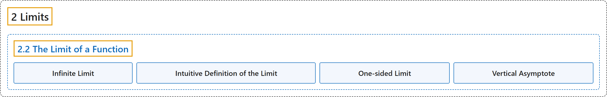

# 2.2 The Limit of a Function

## Classification

## Glossary

| Term | Definition | 中文翻译 | Source |
|---|---|---|---|
| **2 Limits** 极限 | (No definition) | （无定义） | [Strang & Herman, 2016a, chapter 2](https://openstax.org/books/calculus-volume-1/pages/2-introduction) |
| **2.2 The Limit of a Function** 函数的极限 | (No definition) | （无定义） | [Strang & Herman, 2016a, section 2.2](https://openstax.org/books/calculus-volume-1/pages/2-2-the-limit-of-a-function) |
| **Infinite Limit** 无穷极限 | "A function has an infinite limit at a point a if it either **increases or decreases without bound** as it approaches a" | 如果函数在趋近点 a 时**无界地增大或减小**，就说它在 a 处有无穷极限 | [Strang & Herman, 2016a, chapter 2 Key Terms](https://openstax.org/books/calculus-volume-1/pages/2-key-terms#fs-id1170572541944) |
| **Intuitive Definition of the Limit** 极限的直观定义 | "If all values of the function $f(x)$ **approach the real number L** as the values of $x(\ne a)$ approach a, $f(x)$ approaches L" | 如果当 $x(\ne a)$ 的值趋近 a 时函数 $f(x)$ 的所有值都**趋近实数 L**，那么 $f(x)$ 趋近 L | [Strang & Herman, 2016a, chapter 2 Key Terms](https://openstax.org/books/calculus-volume-1/pages/2-key-terms#fs-id1170572467930) |
| **One-sided Limit** 单侧极限 | "A one-sided limit of a function is a limit taken **from either the left or the right**" | 函数的单侧极限是**从左侧或右侧**取的极限 | [Strang & Herman, 2016a, chapter 2 Key Terms](https://openstax.org/books/calculus-volume-1/pages/2-key-terms#fs-id1170572467997) |
| **Vertical Asymptote** 竖直渐近线 | "A function has a vertical asymptote at $x=a$ if the limit as x approaches a from the right or left **is infinite**" | 如果 x 从右侧或左侧趋近 a 时的极限**是无穷**，函数就在 $x=a$ 处有竖直渐近线 | [Strang & Herman, 2016a, chapter 2 Key Terms](https://openstax.org/books/calculus-volume-1/pages/2-key-terms#fs-id1170572468006) |

## References

Strang, G., & Herman, E. (2016a). *Calculus volume 1*. OpenStax. Retrieved October 29, 2026, from <https://openstax.org/details/books/calculus-volume-1>
