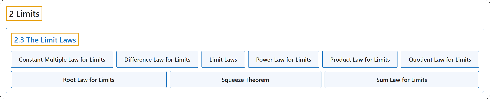

# 2.3 The Limit Laws

## Classification

## Glossary

| Term | Definition | 中文翻译 | Source |
|---|---|---|---|
| **2 Limits** 极限 | (No definition) | （无定义） | [Strang & Herman, 2016a, chapter 2](https://openstax.org/books/calculus-volume-1/pages/2-introduction) |
| **2.3 The Limit Laws** 极限法则 | (No definition) | （无定义） | [Strang & Herman, 2016a, section 2.3](https://openstax.org/books/calculus-volume-1/pages/2-3-the-limit-laws) |
| **Constant Multiple Law for Limits** 极限的常数倍法则 | "**the limit law** $\lim_{x\to a}cf(x)=c\cdot \lim_{x\to a}f(x)=cL$" | **极限法则** $\lim_{x\to a}cf(x)=c\cdot \lim_{x\to a}f(x)=cL$ | [Strang & Herman, 2016a, chapter 2 Key Terms](https://openstax.org/books/calculus-volume-1/pages/2-key-terms#fs-id1170572512680) |
| **Difference Law for Limits** 极限的差法则 | "**the limit law** $\lim_{x\to a}(f(x)-g(x))=\lim_{x\to a}f(x)-\lim_{x\to a}g(x)=L-M$" | **极限法则** $\lim_{x\to a}(f(x)-g(x))=\lim_{x\to a}f(x)-\lim_{x\to a}g(x)=L-M$ | [Strang & Herman, 2016a, chapter 2 Key Terms](https://openstax.org/books/calculus-volume-1/pages/2-key-terms#fs-id1170572512757) |
| **Limit Laws** 极限法则 | "**the individual properties of limits**; for each of the individual laws, let $f(x)$ and $g(x)$ be defined for all $x\ne a$ over some open interval containing a; assume that L and M are real numbers so that $\lim_{x\to a}f(x)=L$ and $\lim_{x\to a}g(x)=M;$ let c be a constant" | **极限的各条性质**；对每条法则，设 $f(x)$ 和 $g(x)$ 在某个包含 a 的开区间上对所有 $x\ne a$ 有定义；设 L 和 M 是实数，使得 $\lim_{x\to a}f(x)=L$ 且 $\lim_{x\to a}g(x)=M;$ 设 c 为常数 | [Strang & Herman, 2016a, chapter 2 Key Terms](https://openstax.org/books/calculus-volume-1/pages/2-key-terms#fs-id1170572478051) |
| **Power Law for Limits** 极限的幂法则 | "**the limit law** $\lim_{x\to a}(f(x))^{n}=(\lim_{x\to a}f(x))^{n}=L^{n}$ for every positive integer n" | **极限法则** $\lim_{x\to a}(f(x))^{n}=(\lim_{x\to a}f(x))^{n}=L^{n}$，对每个正整数 n 成立 | [Strang & Herman, 2016a, chapter 2 Key Terms](https://openstax.org/books/calculus-volume-1/pages/2-key-terms#fs-id1170572541755) |
| **Product Law for Limits** 极限的积法则 | "**the limit law** $\lim_{x\to a}(f(x)\cdot g(x))=\lim_{x\to a}f(x)\cdot \lim_{x\to a}g(x)=L\cdot M$" | **极限法则** $\lim_{x\to a}(f(x)\cdot g(x))=\lim_{x\to a}f(x)\cdot \lim_{x\to a}g(x)=L\cdot M$ | [Strang & Herman, 2016a, chapter 2 Key Terms](https://openstax.org/books/calculus-volume-1/pages/2-key-terms#fs-id1170572541851) |
| **Quotient Law for Limits** 极限的商法则 | "**the limit law** $\lim_{x\to a}\frac{f(x)}{g(x)}=\frac{\lim_{x\to a}f(x)}{\lim_{x\to a}g(x)}=\frac{L}{M}$ for $M\ne 0$" | **极限法则** $\lim_{x\to a}\frac{f(x)}{g(x)}=\frac{\lim_{x\to a}f(x)}{\lim_{x\to a}g(x)}=\frac{L}{M}$，其中 $M\ne 0$ | [Strang & Herman, 2016a, chapter 2 Key Terms](https://openstax.org/books/calculus-volume-1/pages/2-key-terms#fs-id1170572291727) |
| **Root Law for Limits** 极限的根法则 | "**the limit law** $\lim_{x\to a}\sqrt[n]{f(x)}=\sqrt[n]{\lim_{x\to a}f(x)}=\sqrt[n]{L}$ for all L if n is odd and for $L\ge 0$ if n is even" | **极限法则** $\lim_{x\to a}\sqrt[n]{f(x)}=\sqrt[n]{\lim_{x\to a}f(x)}=\sqrt[n]{L}$，n 为奇数时对所有 L 成立，n 为偶数时对 $L\ge 0$ 成立 | [Strang & Herman, 2016a, chapter 2 Key Terms](https://openstax.org/books/calculus-volume-1/pages/2-key-terms#fs-id1170572291845) |
| **Squeeze Theorem** 夹逼定理 | "states that if $f(x)\le g(x)\le h(x)$ for all $x\ne a$ **over an open interval containing a** and $\lim_{x\to a}f(x)=L=\lim_{x\to a}h(x)$ where L is a real number, then $\lim_{x\to a}g(x)=L$" | 指出：若在**包含 a 的开区间上**对所有 $x\ne a$ 有 $f(x)\le g(x)\le h(x)$，且 $\lim_{x\to a}f(x)=L=\lim_{x\to a}h(x)$，其中 L 为实数，则 $\lim_{x\to a}g(x)=L$ | [Strang & Herman, 2016a, chapter 2 Key Terms](https://openstax.org/books/calculus-volume-1/pages/2-key-terms#fs-id1170572418897) |
| **Sum Law for Limits** 极限的和法则 | "**The limit law** $\lim_{x\to a}(f(x)+g(x))=\lim_{x\to a}f(x)+\lim_{x\to a}g(x)=L+M$" | **极限法则** $\lim_{x\to a}(f(x)+g(x))=\lim_{x\to a}f(x)+\lim_{x\to a}g(x)=L+M$ | [Strang & Herman, 2016a, chapter 2 Key Terms](https://openstax.org/books/calculus-volume-1/pages/2-key-terms#fs-id1170572419050) |

## References

Strang, G., & Herman, E. (2016a). *Calculus volume 1*. OpenStax. Retrieved October 29, 2026, from <https://openstax.org/details/books/calculus-volume-1>
