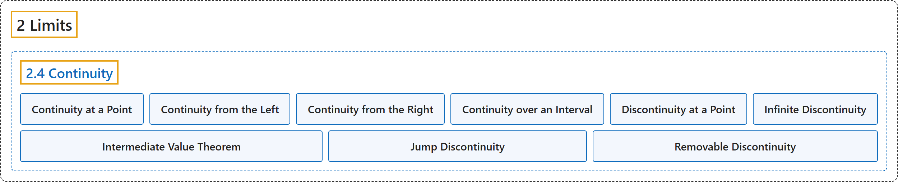

# 2.4 Continuity

## Classification

## Glossary

| Term | Definition | 中文翻译 | Source |
|---|---|---|---|
| **2 Limits** 极限 | (No definition) | （无定义） | [Strang & Herman, 2016a, chapter 2](https://openstax.org/books/calculus-volume-1/pages/2-introduction) |
| **2.4 Continuity** 连续性 | (No definition) | （无定义） | [Strang & Herman, 2016a, section 2.4](https://openstax.org/books/calculus-volume-1/pages/2-4-continuity) |
| **Continuity at a Point** 在一点处连续 | "A function $f(x)$ is continuous at a point a if and only if **the following three conditions are satisfied**: (1) $f(a)$ is defined, (2) $\lim_{x\to a}f(x)$ exists, and (3) $\lim_{x\to a}f(x)=f(a)$" | 函数 $f(x)$ 在点 a 处连续，当且仅当**满足以下三个条件**：(1) $f(a)$ 有定义，(2) $\lim_{x\to a}f(x)$ 存在，(3) $\lim_{x\to a}f(x)=f(a)$ | [Strang & Herman, 2016a, chapter 2 Key Terms](https://openstax.org/books/calculus-volume-1/pages/2-key-terms#fs-id1170571119822) |
| **Continuity from the Left** 左连续 | "A function is **continuous from the left** at b if $\lim_{x\to b^{-}}f(x)=f(b)$" | 如果 $\lim_{x\to b^{-}}f(x)=f(b)$，函数在 b 处**左连续** | [Strang & Herman, 2016a, chapter 2 Key Terms](https://openstax.org/books/calculus-volume-1/pages/2-key-terms#fs-id1170573574137) |
| **Continuity from the Right** 右连续 | "A function is **continuous from the right** at a if $\lim_{x\to a^{+}}f(x)=f(a)$" | 如果 $\lim_{x\to a^{+}}f(x)=f(a)$，函数在 a 处**右连续** | [Strang & Herman, 2016a, chapter 2 Key Terms](https://openstax.org/books/calculus-volume-1/pages/2-key-terms#fs-id1170571275835) |
| **Continuity over an Interval** 在区间上连续 | "a function that can be **traced with a pencil without lifting the pencil**; a function is continuous over an open interval if it is **continuous at every point in the interval**; a function $f(x)$ is continuous over a closed interval of the form $[a,b]$ if it is continuous at every point in $(a,b),$ and it is continuous from the right at a and from the left at b" | 可以**一笔画出而不提笔**的函数；函数在开区间上连续，如果它**在区间内每一点都连续**；函数 $f(x)$ 在形如 $[a,b]$ 的闭区间上连续，如果它在 $(a,b),$ 内每一点连续，且在 a 处右连续、在 b 处左连续 | [Strang & Herman, 2016a, chapter 2 Key Terms](https://openstax.org/books/calculus-volume-1/pages/2-key-terms#fs-id1170573363352) |
| **Discontinuity at a Point** 在一点处间断 | "A function is discontinuous at a point or has a discontinuity at a point if **it is not continuous at the point**" | 如果函数在某点**不连续**，就说它在该点间断，或在该点有间断 | [Strang & Herman, 2016a, chapter 2 Key Terms](https://openstax.org/books/calculus-volume-1/pages/2-key-terms#fs-id1170573573745) |
| **Infinite Discontinuity** 无穷间断 | "**An infinite discontinuity** occurs at a point a if $\lim_{x\to a^{-}}f(x)=\pm \infty$ or $\lim_{x\to a^{+}}f(x)=\pm \infty$" | 如果 $\lim_{x\to a^{-}}f(x)=\pm \infty$ 或 $\lim_{x\to a^{+}}f(x)=\pm \infty$，则在点 a 处出现**无穷间断** | [Strang & Herman, 2016a, chapter 2 Key Terms](https://openstax.org/books/calculus-volume-1/pages/2-key-terms#fs-id1170573573755) |
| **Intermediate Value Theorem** 介值定理 | "Let f be continuous over a closed bounded interval $[\text{a},\text{b}];$ if z is any real number between $f(a)$ and $f(b),$ then **there is a number c** in $[a,b]$ satisfying $f(c)=z$" | 设 f 在有界闭区间 $[\text{a},\text{b}];$ 上连续；若 z 是介于 $f(a)$ 和 $f(b),$ 之间的任一实数，则**存在一个数 c** 属于 $[a,b]$ 满足 $f(c)=z$ | [Strang & Herman, 2016a, chapter 2 Key Terms](https://openstax.org/books/calculus-volume-1/pages/2-key-terms#fs-id1170571049355) |
| **Jump Discontinuity** 跳跃间断 | "A jump discontinuity occurs at a point a if $\lim_{x\to a^{-}}f(x)$ and $\lim_{x\to a^{+}}f(x)$ **both exist**, but $\lim_{x\to a^{-}}f(x)\ne \lim_{x\to a^{+}}f(x)$" | 如果 $\lim_{x\to a^{-}}f(x)$ 和 $\lim_{x\to a^{+}}f(x)$ **都存在**，但 $\lim_{x\to a^{-}}f(x)\ne \lim_{x\to a^{+}}f(x)$，则在点 a 处出现跳跃间断 | [Strang & Herman, 2016a, chapter 2 Key Terms](https://openstax.org/books/calculus-volume-1/pages/2-key-terms#fs-id1170570997709) |
| **Removable Discontinuity** 可去间断 | "A removable discontinuity occurs at a point a if $f(x)$ is discontinuous at a, but $\lim_{x\to a}f(x)$ **exists**" | 如果 $f(x)$ 在 a 处间断，但 $\lim_{x\to a}f(x)$ **存在**，则在点 a 处出现可去间断 | [Strang & Herman, 2016a, chapter 2 Key Terms](https://openstax.org/books/calculus-volume-1/pages/2-key-terms#fs-id1170571146508) |

## References

Strang, G., & Herman, E. (2016a). *Calculus volume 1*. OpenStax. Retrieved October 29, 2026, from <https://openstax.org/details/books/calculus-volume-1>
