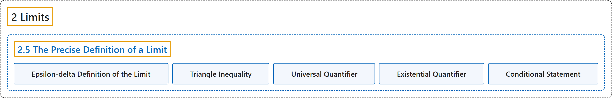

# 2.5 The Precise Definition of a Limit

## Classification

## Glossary

| Term | Definition | 中文翻译 | Source |
|---|---|---|---|
| **2 Limits** 极限 | (No definition) | （无定义） | [Strang & Herman, 2016a, chapter 2](https://openstax.org/books/calculus-volume-1/pages/2-introduction) |
| **2.5 The Precise Definition of a Limit** 极限的精确定义 | (No definition) | （无定义） | [Strang & Herman, 2016a, section 2.5](https://openstax.org/books/calculus-volume-1/pages/2-5-the-precise-definition-of-a-limit) |
| **Epsilon-delta Definition of the Limit** 极限的 ε-δ 定义 | "$\lim_{x\to a}f(x)=L$ if for every $\varepsilon >0,$ **there exists a** $\delta >0$ such that if $0<\vert x-a\vert <\delta ,$ then $\vert f(x)-L\vert <\varepsilon$" | $\lim_{x\to a}f(x)=L$，如果对每个 $\varepsilon >0,$ **都存在一个** $\delta >0$，使得若 $0<\vert x-a\vert <\delta ,$ 则 $\vert f(x)-L\vert <\varepsilon$ | [Strang & Herman, 2016a, chapter 2 Key Terms](https://openstax.org/books/calculus-volume-1/pages/2-key-terms#fs-id1170572386184) |
| **Triangle Inequality** 三角不等式 | "If a and b **are any real numbers**, then $\vert a+b\vert \le \vert a\vert +\vert b\vert$" | 若 a 和 b **是任意实数**，则 $\vert a+b\vert \le \vert a\vert +\vert b\vert$ | [Strang & Herman, 2016a, chapter 2 Key Terms](https://openstax.org/books/calculus-volume-1/pages/2-key-terms#fs-id1170572643277) |
| **Universal Quantifier** 全称量词 | "The statement itself involves something called a **universal quantifier** (for every $\varepsilon >0\text{),}$ an existential quantifier (there exists a $\delta >0\text{),}$ and, last, a conditional statement (if $0<\vert x-a\vert <\delta ,$ then $\vert f(x)-L\vert <\varepsilon \text{).}$" | 这个陈述本身涉及所谓的**全称量词**（对每个 $\varepsilon >0\text{),}$ 一个存在量词（存在 $\delta >0\text{),}$ 最后还有一个条件语句（若 $0<\vert x-a\vert <\delta ,$ 则 $\vert f(x)-L\vert <\varepsilon \text{).}$ | [Strang & Herman, 2016a, section 2.5](https://openstax.org/books/calculus-volume-1/pages/2-5-the-precise-definition-of-a-limit#term-00002) |
| **Existential Quantifier** 存在量词 | "The statement itself involves something called a universal quantifier (for every $\varepsilon >0\text{),}$ an **existential quantifier** (there exists a $\delta >0\text{),}$ and, last, a conditional statement (if $0<\vert x-a\vert <\delta ,$ then $\vert f(x)-L\vert <\varepsilon \text{).}$" | 这个陈述本身涉及所谓的全称量词（对每个 $\varepsilon >0\text{),}$ 一个**存在量词**（存在 $\delta >0\text{),}$ 最后还有一个条件语句（若 $0<\vert x-a\vert <\delta ,$ 则 $\vert f(x)-L\vert <\varepsilon \text{).}$ | [Strang & Herman, 2016a, section 2.5](https://openstax.org/books/calculus-volume-1/pages/2-5-the-precise-definition-of-a-limit#term-00003) |
| **Conditional Statement** 条件语句 | "The statement itself involves something called a universal quantifier (for every $\varepsilon >0\text{),}$ an existential quantifier (there exists a $\delta >0\text{),}$ and, last, a **conditional statement** (if $0<\vert x-a\vert <\delta ,$ then $\vert f(x)-L\vert <\varepsilon \text{).}$" | 这个陈述本身涉及所谓的全称量词（对每个 $\varepsilon >0\text{),}$ 一个存在量词（存在 $\delta >0\text{),}$ 最后还有一个**条件语句**（若 $0<\vert x-a\vert <\delta ,$ 则 $\vert f(x)-L\vert <\varepsilon \text{).}$ | [Strang & Herman, 2016a, section 2.5](https://openstax.org/books/calculus-volume-1/pages/2-5-the-precise-definition-of-a-limit#term-00004) |

## References

Strang, G., & Herman, E. (2016a). *Calculus volume 1*. OpenStax. Retrieved October 29, 2026, from <https://openstax.org/details/books/calculus-volume-1>
