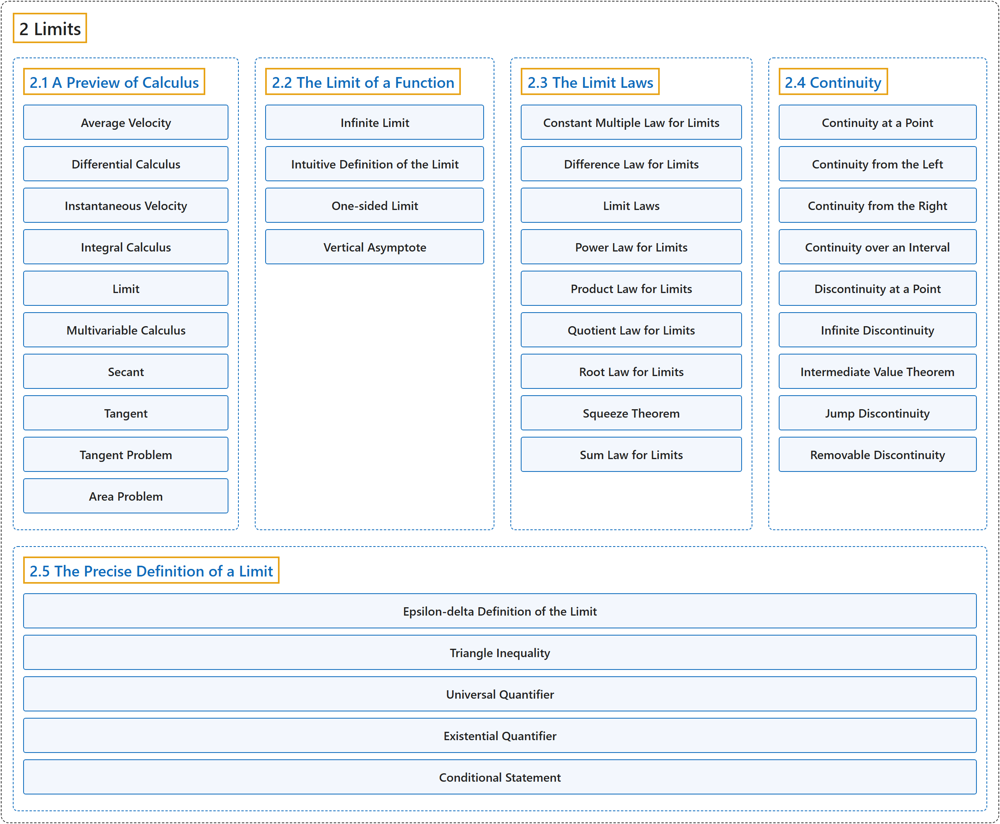

# 2 Limits

## Classification

## Glossary

| Term | Definition | 中文翻译 | Source |
|---|---|---|---|
| **2 Limits** 极限 | (No definition) | （无定义） | [Strang & Herman, 2016a, chapter 2](https://openstax.org/books/calculus-volume-1/pages/2-introduction) |
| **[2.1 A Preview of Calculus](2-1-a-preview-of-calculus.md)** 微积分预览 | (No definition) | （无定义） | [Strang & Herman, 2016a, section 2.1](https://openstax.org/books/calculus-volume-1/pages/2-1-a-preview-of-calculus) |
| **[2.2 The Limit of a Function](2-2-the-limit-of-a-function.md)** 函数的极限 | (No definition) | （无定义） | [Strang & Herman, 2016a, section 2.2](https://openstax.org/books/calculus-volume-1/pages/2-2-the-limit-of-a-function) |
| **[2.3 The Limit Laws](2-3-the-limit-laws.md)** 极限法则 | (No definition) | （无定义） | [Strang & Herman, 2016a, section 2.3](https://openstax.org/books/calculus-volume-1/pages/2-3-the-limit-laws) |
| **[2.4 Continuity](2-4-continuity.md)** 连续性 | (No definition) | （无定义） | [Strang & Herman, 2016a, section 2.4](https://openstax.org/books/calculus-volume-1/pages/2-4-continuity) |
| **[2.5 The Precise Definition of a Limit](2-5-the-precise-definition-of-a-limit.md)** 极限的精确定义 | (No definition) | （无定义） | [Strang & Herman, 2016a, section 2.5](https://openstax.org/books/calculus-volume-1/pages/2-5-the-precise-definition-of-a-limit) |

## References

Strang, G., & Herman, E. (2016a). *Calculus volume 1*. OpenStax. Retrieved October 29, 2026, from <https://openstax.org/details/books/calculus-volume-1>
