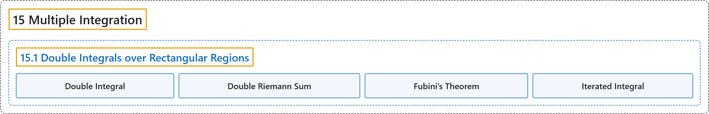

# 15.1 Double Integrals over Rectangular Regions

## Classification

## Glossary

| Term | Definition | 中文翻译 | Source |
|---|---|---|---|
| **15 Multiple Integration** 重积分 | (No definition) | （无定义） | [Strang & Herman, 2016c, chapter 5](https://openstax.org/books/calculus-volume-3/pages/5-introduction) |
| **15.1 Double Integrals over Rectangular Regions** 矩形区域上的二重积分 | (No definition) | （无定义） | [Strang & Herman, 2016c, section 5.1](https://openstax.org/books/calculus-volume-3/pages/5-1-double-integrals-over-rectangular-regions) |
| **Double Integral** 二重积分 | "of the function $f(x,y)$ over the region $R$ in the $xy$-plane is defined as **the limit of a double Riemann sum**, $\underset{R}{\iint }f(x,y)dA=\lim_{m,n\to \infty }\sum_{i=1}^{m}\sum_{j=1}^{n}f(x_{ij}^{*},y_{ij}^{*})\Delta A.$" | 函数 $f(x,y)$ 在 $xy$ 平面中区域 $R$ 上的二重积分定义为**二重黎曼和的极限**，$\underset{R}{\iint }f(x,y)dA=\lim_{m,n\to \infty }\sum_{i=1}^{m}\sum_{j=1}^{n}f(x_{ij}^{*},y_{ij}^{*})\Delta A$。 | [Strang & Herman, 2016c, chapter 5 Key Terms](https://openstax.org/books/calculus-volume-3/pages/5-key-terms#fs-id1167793718582) |
| **Double Riemann Sum** 二重黎曼和 | "of the function $f(x,y)$ over a rectangular region $R$ is $\sum_{i=1}^{m}\sum_{j=1}^{n}f(x_{ij}^{*},y_{ij}^{*})\Delta A$ where $R$ **is divided into smaller subrectangles** $R_{ij}$ and $(x_{ij}^{*},y_{ij}^{*})$ is an arbitrary point in $R_{ij}$" | 函数 $f(x,y)$ 在矩形区域 $R$ 上的二重黎曼和是 $\sum_{i=1}^{m}\sum_{j=1}^{n}f(x_{ij}^{*},y_{ij}^{*})\Delta A$，其中 $R$ **被分成更小的子矩形** $R_{ij}$，$(x_{ij}^{*},y_{ij}^{*})$ 是 $R_{ij}$ 中任意一点 | [Strang & Herman, 2016c, chapter 5 Key Terms](https://openstax.org/books/calculus-volume-3/pages/5-key-terms#fs-id1167793941054) |
| **Fubini’s Theorem** 富比尼定理 | "if $f(x,y)$ is a function of two variables that is continuous over a rectangular region $R=\{(x,y)\in \mathbb{R}^{2}\vert a\le x\le b,c\le y\le d\},$ then the double integral of $f$ over the region **equals an iterated integral**, $\underset{R}{\iint }f(x,y)dy\,dx={\int }_{a}^{b}{\int }_{c}^{d}f(x,y)dx\,dy={\int }_{c}^{d}{\int }_{a}^{b}f(x,y)dx\,dy$" | 若 $f(x,y)$ 是在矩形区域 $R=\{(x,y)\in \mathbb{R}^{2}\vert a\le x\le b,c\le y\le d\},$ 上连续的二元函数，则 $f$ 在该区域上的二重积分**等于累次积分**，$\underset{R}{\iint }f(x,y)dy\,dx={\int }_{a}^{b}{\int }_{c}^{d}f(x,y)dx\,dy={\int }_{c}^{d}{\int }_{a}^{b}f(x,y)dx\,dy$ | [Strang & Herman, 2016c, chapter 5 Key Terms](https://openstax.org/books/calculus-volume-3/pages/5-key-terms#fs-id1167794295527) |
| **Iterated Integral** 累次积分 | "for a function $f(x,y)$ over the region $R$ is ${\int }_{a}^{b}{\int }_{c}^{d}f(x,y)dx\,dy={\int }_{a}^{b}[{\int }_{c}^{d}f(x,y)dy]dx,$ ${\int }_{c}^{d}{\int }_{b}^{a}f(x,y)dx\,dy={\int }_{c}^{d}[{\int }_{a}^{b}f(x,y)dx]dy,$ where $a,b,c,$ and $d$ **are any real numbers** and $R=[a,b]\,\times \,[c,d]$" | 函数 $f(x,y)$ 在区域 $R$ 上的累次积分是 ${\int }_{a}^{b}{\int }_{c}^{d}f(x,y)dx\,dy={\int }_{a}^{b}[{\int }_{c}^{d}f(x,y)dy]dx,$ ${\int }_{c}^{d}{\int }_{b}^{a}f(x,y)dx\,dy={\int }_{c}^{d}[{\int }_{a}^{b}f(x,y)dx]dy,$ 其中 $a,b,c,$ 和 $d$ **是任意实数**，且 $R=[a,b]\,\times \,[c,d]$ | [Strang & Herman, 2016c, chapter 5 Key Terms](https://openstax.org/books/calculus-volume-3/pages/5-key-terms#fs-id1167793582839) |

## References

Strang, G., & Herman, E. (2016c). *Calculus volume 3*. OpenStax. Retrieved October 29, 2026, from <https://openstax.org/details/books/calculus-volume-3>
