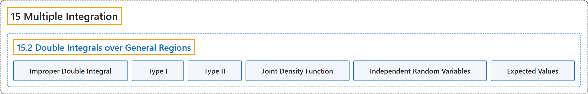

# 15.2 Double Integrals over General Regions

## Classification

## Glossary

| Term | Definition | 中文翻译 | Source |
|---|---|---|---|
| **15 Multiple Integration** 重积分 | (No definition) | （无定义） | [Strang & Herman, 2016c, chapter 5](https://openstax.org/books/calculus-volume-3/pages/5-introduction) |
| **15.2 Double Integrals over General Regions** 一般区域上的二重积分 | (No definition) | （无定义） | [Strang & Herman, 2016c, section 5.2](https://openstax.org/books/calculus-volume-3/pages/5-2-double-integrals-over-general-regions) |
| **Improper Double Integral** 反常二重积分 | "a double integral over **an unbounded region or of an unbounded function**" | 在**无界区域上或对无界函数**的二重积分 | [Strang & Herman, 2016c, chapter 5 Key Terms](https://openstax.org/books/calculus-volume-3/pages/5-key-terms#fs-id1167793711544) |
| **Type I** I 型区域 | "a region $D$ in the $xy$-plane is Type I if it lies **between two vertical lines** and the graphs of two continuous functions $g_{1}(x)$ and $g_{2}(x)$" | $xy$ 平面中的区域 $D$ 是 I 型的，如果它位于**两条竖直线之间**以及两个连续函数 $g_{1}(x)$ 和 $g_{2}(x)$ 的图像之间 | [Strang & Herman, 2016c, chapter 5 Key Terms](https://openstax.org/books/calculus-volume-3/pages/5-key-terms#fs-id1167793711554) |
| **Type II** II 型区域 | "a region $D$ in the $xy$-plane is Type II if it lies **between two horizontal lines** and the graphs of two continuous functions $h_{1}(y)\,\text{and}\,h_{2}(y)$" | $xy$ 平面中的区域 $D$ 是 II 型的，如果它位于**两条水平线之间**以及两个连续函数 $h_{1}(y)\,\text{and}\,h_{2}(y)$ 的图像之间 | [Strang & Herman, 2016c, chapter 5 Key Terms](https://openstax.org/books/calculus-volume-3/pages/5-key-terms#fs-id1167793711608) |
| **Joint Density Function** 联合密度函数 | "**The joint density function** $f$ of $X$ and $Y$ satisfies the probability that $(X,Y)$ lies in a certain region $D\text{:}$" | $X$ 和 $Y$ 的**联合密度函数** $f$ 满足 $(X,Y)$ 落在某个区域 $D\text{:}$ 中的概率 | [Strang & Herman, 2016c, section 5.2](https://openstax.org/books/calculus-volume-3/pages/5-2-double-integrals-over-general-regions#term-00004) |
| **Independent Random Variables** 独立随机变量 | "The variables $X$ and $Y$ are said to be **independent random variables** if their joint density function is the product of their individual density functions:" | 如果变量 $X$ 和 $Y$ 的联合密度函数是各自密度函数之积，就说它们是**独立随机变量**： | [Strang & Herman, 2016c, section 5.2](https://openstax.org/books/calculus-volume-3/pages/5-2-double-integrals-over-general-regions#term-00005) |
| **Expected Values** 期望值 | "In probability theory, we denote **the expected values** $E(X)$ and $E(Y),$ respectively, as the most likely outcomes of the events." | 在概率论中，我们把**期望值** $E(X)$ 和 $E(Y),$ 分别记为事件最可能的结果。 | [Strang & Herman, 2016c, section 5.2](https://openstax.org/books/calculus-volume-3/pages/5-2-double-integrals-over-general-regions#term-00006) |

## References

Strang, G., & Herman, E. (2016c). *Calculus volume 3*. OpenStax. Retrieved October 29, 2026, from <https://openstax.org/details/books/calculus-volume-3>
