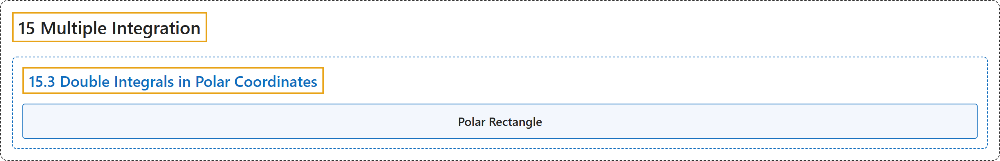

# 15.3 Double Integrals in Polar Coordinates

## Classification

## Glossary

| Term | Definition | 中文翻译 | Source |
|---|---|---|---|
| **15 Multiple Integration** 重积分 | (No definition) | （无定义） | [Strang & Herman, 2016c, chapter 5](https://openstax.org/books/calculus-volume-3/pages/5-introduction) |
| **15.3 Double Integrals in Polar Coordinates** 极坐标下的二重积分 | (No definition) | （无定义） | [Strang & Herman, 2016c, section 5.3](https://openstax.org/books/calculus-volume-3/pages/5-3-double-integrals-in-polar-coordinates) |
| **Polar Rectangle** 极矩形 | "**the region enclosed between the circles** $r=a$ and $r=b$ and the angles $\theta =\alpha$ and $\theta =\beta ;$ it is described as $R=\{(r,\theta )\vert a\le r\le b,\alpha \le \theta \le \beta \}$" | **由圆 $r=a$ 和 $r=b$ 以及角 $\theta =\alpha$ 和 $\theta =\beta ;$ 围成的区域**；它被描述为 $R=\{(r,\theta )\vert a\le r\le b,\alpha \le \theta \le \beta \}$ | [Strang & Herman, 2016c, chapter 5 Key Terms](https://openstax.org/books/calculus-volume-3/pages/5-key-terms#fs-id1167793423282) |

## References

Strang, G., & Herman, E. (2016c). *Calculus volume 3*. OpenStax. Retrieved October 29, 2026, from <https://openstax.org/details/books/calculus-volume-3>
