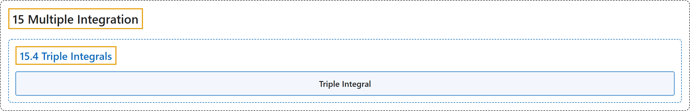

# 15.4 Triple Integrals

## Classification

## Glossary

| Term | Definition | 中文翻译 | Source |
|---|---|---|---|
| **15 Multiple Integration** 重积分 | (No definition) | （无定义） | [Strang & Herman, 2016c, chapter 5](https://openstax.org/books/calculus-volume-3/pages/5-introduction) |
| **15.4 Triple Integrals** 三重积分 | (No definition) | （无定义） | [Strang & Herman, 2016c, section 5.4](https://openstax.org/books/calculus-volume-3/pages/5-4-triple-integrals) |
| **Triple Integral** 三重积分 | "the triple integral of a continuous function $f(x,y,z)$ over a rectangular solid box $B$ is **the limit of a Riemann sum for a function of three variables**, if this limit exists" | 连续函数 $f(x,y,z)$ 在长方体 $B$ 上的三重积分是**三元函数黎曼和的极限**（若这个极限存在） | [Strang & Herman, 2016c, chapter 5 Key Terms](https://openstax.org/books/calculus-volume-3/pages/5-key-terms#fs-id1167793512090) |

## References

Strang, G., & Herman, E. (2016c). *Calculus volume 3*. OpenStax. Retrieved October 29, 2026, from <https://openstax.org/details/books/calculus-volume-3>
