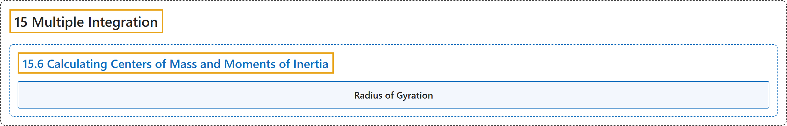

# 15.6 Calculating Centers of Mass and Moments of Inertia

## Classification

## Glossary

| Term | Definition | 中文翻译 | Source |
|---|---|---|---|
| **15 Multiple Integration** 重积分 | (No definition) | （无定义） | [Strang & Herman, 2016c, chapter 5](https://openstax.org/books/calculus-volume-3/pages/5-introduction) |
| **15.6 Calculating Centers of Mass and Moments of Inertia** 质心与转动惯量的计算 | (No definition) | （无定义） | [Strang & Herman, 2016c, section 5.6](https://openstax.org/books/calculus-volume-3/pages/5-6-calculating-centers-of-mass-and-moments-of-inertia) |
| **Radius of Gyration** 回转半径 | "the distance between the rotational axis of the object and the point where the entire mass of the object can be concentrated and **have the same moment of inertia**" | 物体转轴与这样一点之间的距离：物体全部质量可以集中于该点并**具有相同的转动惯量** | [Strang & Herman, 2016c, chapter 5 Key Terms](https://openstax.org/books/calculus-volume-3/pages/5-key-terms#fs-id1167793480090) |

## References

Strang, G., & Herman, E. (2016c). *Calculus volume 3*. OpenStax. Retrieved October 29, 2026, from <https://openstax.org/details/books/calculus-volume-3>
