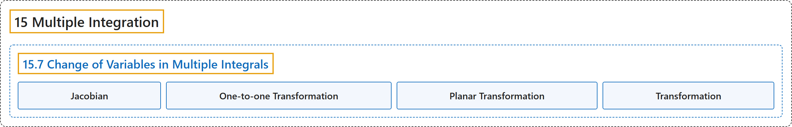

# 15.7 Change of Variables in Multiple Integrals

## Classification

## Glossary

| Term | Definition | 中文翻译 | Source |
|---|---|---|---|
| **15 Multiple Integration** 重积分 | (No definition) | （无定义） | [Strang & Herman, 2016c, chapter 5](https://openstax.org/books/calculus-volume-3/pages/5-introduction) |
| **15.7 Change of Variables in Multiple Integrals** 重积分的换元 | (No definition) | （无定义） | [Strang & Herman, 2016c, section 5.7](https://openstax.org/books/calculus-volume-3/pages/5-7-change-of-variables-in-multiple-integrals) |
| **Jacobian** 雅可比行列式 | "the Jacobian $J(u,v)$ in two variables is a $2\,\times \,2$ **determinant**: $J(u,v)=\begin{vmatrix}\frac{\partial x}{\partial u} & \frac{\partial y}{\partial u} \\ \frac{\partial x}{\partial v} & \frac{\partial y}{\partial v}\end{vmatrix};$ the Jacobian $J(u,v,w)$ in three variables is a $3\,\times \,3$ determinant: $J(u,v,w)=\begin{vmatrix}\frac{\partial x}{\partial u} & \frac{\partial y}{\partial u} & \frac{\partial z}{\partial u} \\ \frac{\partial x}{\partial v} & \frac{\partial y}{\partial v} & \frac{\partial z}{\partial v} \\ \frac{\partial x}{\partial w} & \frac{\partial y}{\partial w} & \frac{\partial z}{\partial w}\end{vmatrix}$" | 二元的雅可比行列式 $J(u,v)$ 是一个 $2\,\times \,2$ **行列式**：$J(u,v)=\begin{vmatrix}\frac{\partial x}{\partial u} & \frac{\partial y}{\partial u} \\ \frac{\partial x}{\partial v} & \frac{\partial y}{\partial v}\end{vmatrix};$ 三元的雅可比行列式 $J(u,v,w)$ 是一个 $3\,\times \,3$ 行列式：$J(u,v,w)=\begin{vmatrix}\frac{\partial x}{\partial u} & \frac{\partial y}{\partial u} & \frac{\partial z}{\partial u} \\ \frac{\partial x}{\partial v} & \frac{\partial y}{\partial v} & \frac{\partial z}{\partial v} \\ \frac{\partial x}{\partial w} & \frac{\partial y}{\partial w} & \frac{\partial z}{\partial w}\end{vmatrix}$ | [Strang & Herman, 2016c, chapter 5 Key Terms](https://openstax.org/books/calculus-volume-3/pages/5-key-terms#fs-id1167794222596) |
| **One-to-one Transformation** 一一变换 | "a transformation $T:G\to R$ defined as $T(u,v)=(x,y)$ is said to be one-to-one if **no two points map to the same image point**" | 定义为 $T(u,v)=(x,y)$ 的变换 $T:G\to R$ 称为一一的，如果**没有两个点映射到同一个像点** | [Strang & Herman, 2016c, chapter 5 Key Terms](https://openstax.org/books/calculus-volume-3/pages/5-key-terms#fs-id1167794222171) |
| **Planar Transformation** 平面变换 | "a function $T$ that transforms a region $G$ in one plane into a region $R$ in another plane **by a change of variables**" | **通过变量替换**把一个平面中的区域 $G$ 变成另一个平面中的区域 $R$ 的函数 $T$ | [Strang & Herman, 2016c, chapter 5 Key Terms](https://openstax.org/books/calculus-volume-3/pages/5-key-terms#fs-id1167794222230) |
| **Transformation** 变换 | "a function that transforms a region $G$ in one plane into a region $R$ in another plane **by a change of variables**" | **通过变量替换**把一个平面中的区域 $G$ 变成另一个平面中的区域 $R$ 的函数 | [Strang & Herman, 2016c, chapter 5 Key Terms](https://openstax.org/books/calculus-volume-3/pages/5-key-terms#fs-id1167794222253) |

## References

Strang, G., & Herman, E. (2016c). *Calculus volume 3*. OpenStax. Retrieved October 29, 2026, from <https://openstax.org/details/books/calculus-volume-3>
