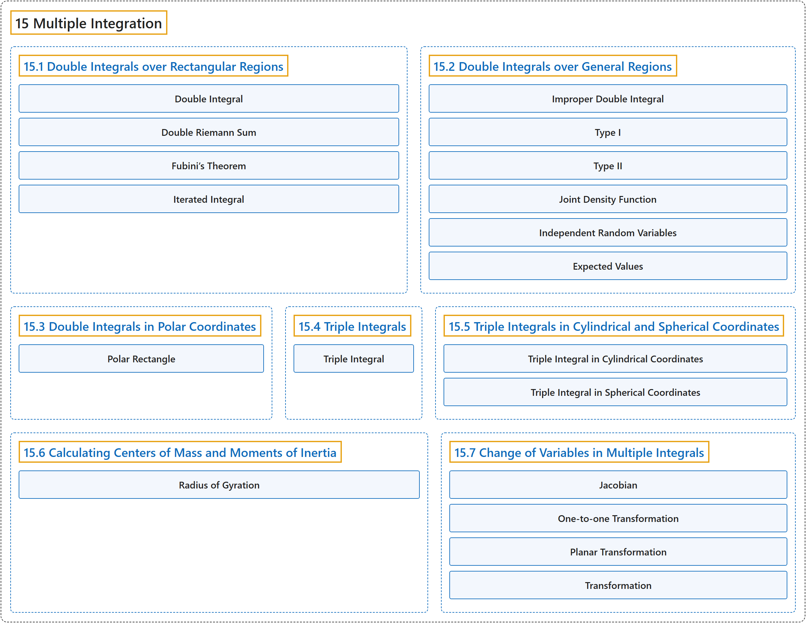

# 15 Multiple Integration

## Classification

## Glossary

| Term | Definition | 中文翻译 | Source |
|---|---|---|---|
| **15 Multiple Integration** 重积分 | (No definition) | （无定义） | [Strang & Herman, 2016c, chapter 5](https://openstax.org/books/calculus-volume-3/pages/5-introduction) |
| **[15.1 Double Integrals over Rectangular Regions](15-1-double-integrals-over-rectangular-regions.md)** 矩形区域上的二重积分 | (No definition) | （无定义） | [Strang & Herman, 2016c, section 5.1](https://openstax.org/books/calculus-volume-3/pages/5-1-double-integrals-over-rectangular-regions) |
| **[15.2 Double Integrals over General Regions](15-2-double-integrals-over-general-regions.md)** 一般区域上的二重积分 | (No definition) | （无定义） | [Strang & Herman, 2016c, section 5.2](https://openstax.org/books/calculus-volume-3/pages/5-2-double-integrals-over-general-regions) |
| **[15.3 Double Integrals in Polar Coordinates](15-3-double-integrals-in-polar-coordinates.md)** 极坐标下的二重积分 | (No definition) | （无定义） | [Strang & Herman, 2016c, section 5.3](https://openstax.org/books/calculus-volume-3/pages/5-3-double-integrals-in-polar-coordinates) |
| **[15.4 Triple Integrals](15-4-triple-integrals.md)** 三重积分 | (No definition) | （无定义） | [Strang & Herman, 2016c, section 5.4](https://openstax.org/books/calculus-volume-3/pages/5-4-triple-integrals) |
| **[15.5 Triple Integrals in Cylindrical and Spherical Coordinates](15-5-triple-integrals-in-cylindrical-and-spherical-coordinates.md)** 柱坐标与球坐标下的三重积分 | (No definition) | （无定义） | [Strang & Herman, 2016c, section 5.5](https://openstax.org/books/calculus-volume-3/pages/5-5-triple-integrals-in-cylindrical-and-spherical-coordinates) |
| **[15.6 Calculating Centers of Mass and Moments of Inertia](15-6-calculating-centers-of-mass-and-moments-of-inertia.md)** 质心与转动惯量的计算 | (No definition) | （无定义） | [Strang & Herman, 2016c, section 5.6](https://openstax.org/books/calculus-volume-3/pages/5-6-calculating-centers-of-mass-and-moments-of-inertia) |
| **[15.7 Change of Variables in Multiple Integrals](15-7-change-of-variables-in-multiple-integrals.md)** 重积分的换元 | (No definition) | （无定义） | [Strang & Herman, 2016c, section 5.7](https://openstax.org/books/calculus-volume-3/pages/5-7-change-of-variables-in-multiple-integrals) |

## References

Strang, G., & Herman, E. (2016c). *Calculus volume 3*. OpenStax. Retrieved October 29, 2026, from <https://openstax.org/details/books/calculus-volume-3>
