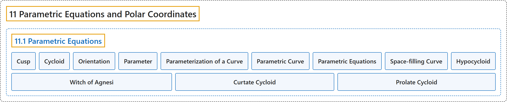

# 11.1 Parametric Equations

## Classification

## Glossary

| Term | Definition | 中文翻译 | Source |
|---|---|---|---|
| **11 Parametric Equations and Polar Coordinates** 参数方程与极坐标 | (No definition) | （无定义） | [Strang & Herman, 2016b, chapter 7](https://openstax.org/books/calculus-volume-2/pages/7-introduction) |
| **11.1 Parametric Equations** 参数方程 | (No definition) | （无定义） | [Strang & Herman, 2016b, section 7.1](https://openstax.org/books/calculus-volume-2/pages/7-1-parametric-equations) |
| **Cusp** 尖点 | "**a pointed end or part where two curves meet**" | **两条曲线相交处的尖端或尖部** | [Strang & Herman, 2016b, chapter 7 Key Terms](https://openstax.org/books/calculus-volume-2/pages/7-key-terms#fs-id1169293394905) |
| **Cycloid** 摆线 | "the curve traced by **a point on the rim of a circular wheel** as the wheel rolls along a straight line without slippage" | 车轮沿直线无滑动滚动时，**圆形车轮边缘上一点**描出的曲线 | [Strang & Herman, 2016b, chapter 7 Key Terms](https://openstax.org/books/calculus-volume-2/pages/7-key-terms#fs-id1169293394894) |
| **Orientation** 方向 | "the direction that a point moves on a graph **as the parameter increases**" | **参数增大时**一点在图像上移动的方向 | [Strang & Herman, 2016b, chapter 7 Key Terms](https://openstax.org/books/calculus-volume-2/pages/7-key-terms#fs-id1169293394914) |
| **Parameter** 参数 | "**an independent variable that both x and y depend on** in a parametric curve; usually represented by the variable t" | 参数曲线中 **x 和 y 都依赖的自变量**；通常用变量 t 表示 | [Strang & Herman, 2016b, chapter 7 Key Terms](https://openstax.org/books/calculus-volume-2/pages/7-key-terms#fs-id1169293394924) |
| **Parameterization of a Curve** 曲线的参数化 | "rewriting the equation of a curve defined by a function $y=f(x)$ **as parametric equations**" | 把由函数 $y=f(x)$ 定义的曲线方程改写**为参数方程** | [Strang & Herman, 2016b, chapter 7 Key Terms](https://openstax.org/books/calculus-volume-2/pages/7-key-terms#fs-id1169293296469) |
| **Parametric Curve** 参数曲线 | "**the graph of the parametric equations** $x(t)$ and $y(t)$ over an interval $a\le t\le b$ combined with the equations" | **参数方程 $x(t)$ 和 $y(t)$ 在区间 $a\le t\le b$ 上的图像**，连同这些方程 | [Strang & Herman, 2016b, chapter 7 Key Terms](https://openstax.org/books/calculus-volume-2/pages/7-key-terms#fs-id1169293394948) |
| **Parametric Equations** 参数方程 | "the equations $x=x(t)$ and $y=y(t)$ that **define a parametric curve**" | **定义参数曲线**的方程 $x=x(t)$ 和 $y=y(t)$ | [Strang & Herman, 2016b, chapter 7 Key Terms](https://openstax.org/books/calculus-volume-2/pages/7-key-terms#fs-id1169293296425) |
| **Space-filling Curve** 空间填充曲线 | "a curve that **completely occupies a two-dimensional subset of the real plane**" | **完全占满实平面某个二维子集**的曲线 | [Strang & Herman, 2016b, chapter 7 Key Terms](https://openstax.org/books/calculus-volume-2/pages/7-key-terms#fs-id1167794188629) |
| **Hypocycloid** 内摆线 | "A point on the edge of the green circle traces out the red graph, which is called **a hypocycloid**." | 绿色圆边缘上的一点描出红色图像，这条曲线称为**内摆线**。 | [Strang & Herman, 2016b, section 7.1](https://openstax.org/books/calculus-volume-2/pages/7-1-parametric-equations#term-00008) |
| **Witch of Agnesi** 阿涅西箕舌线 | "However, perhaps the strangest name for a curve is **the witch of Agnesi**." | 不过，曲线中最奇怪的名字或许是**阿涅西箕舌线**。 | [Strang & Herman, 2016b, section 7.1](https://openstax.org/books/calculus-volume-2/pages/7-1-parametric-equations#term-00011) |
| **Curtate Cycloid** 短辐摆线 | "The new path has less up-and-down motion and is called **a curtate cycloid** (Figure 7.14)." | 新路径的上下起伏较小，称为**短辐摆线**（图 7.14）。 | [Strang & Herman, 2016b, section 7.1](https://openstax.org/books/calculus-volume-2/pages/7-1-parametric-equations#term-00012) |
| **Prolate Cycloid** 长辐摆线 | "When the distance from the center of the wheel to the ant is greater than the radius of the wheel, his path of motion is called **a prolate cycloid**." | 当车轮中心到蚂蚁的距离大于车轮半径时，它的运动路径称为**长辐摆线**。 | [Strang & Herman, 2016b, section 7.1](https://openstax.org/books/calculus-volume-2/pages/7-1-parametric-equations#term-00013) |

## References

Strang, G., & Herman, E. (2016b). *Calculus volume 2*. OpenStax. Retrieved October 29, 2026, from <https://openstax.org/details/books/calculus-volume-2>
