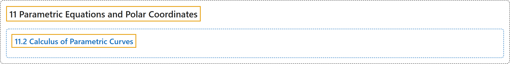

# 11.2 Calculus of Parametric Curves

## Classification

## Glossary

| Term | Definition | 中文翻译 | Source |
|---|---|---|---|
| **11 Parametric Equations and Polar Coordinates** 参数方程与极坐标 | (No definition) | （无定义） | [Strang & Herman, 2016b, chapter 7](https://openstax.org/books/calculus-volume-2/pages/7-introduction) |
| **11.2 Calculus of Parametric Curves** 参数曲线的微积分 | (No definition) | （无定义） | [Strang & Herman, 2016b, section 7.2](https://openstax.org/books/calculus-volume-2/pages/7-2-calculus-of-parametric-curves) |

## References

Strang, G., & Herman, E. (2016b). *Calculus volume 2*. OpenStax. Retrieved October 29, 2026, from <https://openstax.org/details/books/calculus-volume-2>
