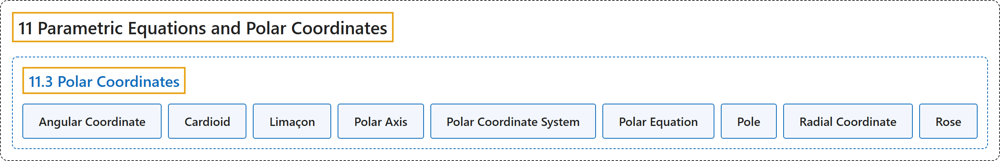

# 11.3 Polar Coordinates

## Classification

## Glossary

| Term | Definition | 中文翻译 | Source |
|---|---|---|---|
| **11 Parametric Equations and Polar Coordinates** 参数方程与极坐标 | (No definition) | （无定义） | [Strang & Herman, 2016b, chapter 7](https://openstax.org/books/calculus-volume-2/pages/7-introduction) |
| **11.3 Polar Coordinates** 极坐标 | (No definition) | （无定义） | [Strang & Herman, 2016b, section 7.3](https://openstax.org/books/calculus-volume-2/pages/7-3-polar-coordinates) |
| **Angular Coordinate** 角坐标 | "$\theta$ the angle formed by a line segment connecting the origin to a point in the polar coordinate system with the positive radial (x) axis, **measured counterclockwise**" | $\theta$ 极坐标系中连接原点与一点的线段同正径向（x）轴所成的角，**按逆时针方向度量** | [Strang & Herman, 2016b, chapter 7 Key Terms](https://openstax.org/books/calculus-volume-2/pages/7-key-terms#fs-id1167794188366) |
| **Cardioid** 心形线 | "a plane curve traced by a point on the perimeter of a circle that is **rolling around a fixed circle of the same radius**; the equation of a cardioid is $r=a(1+\sin \,\theta )$ or $r=a(1+\cos \,\theta )$" | 一个圆**绕同半径的定圆滚动**时，其圆周上一点描出的平面曲线；心形线的方程是 $r=a(1+\sin \,\theta )$ 或 $r=a(1+\cos \,\theta )$ | [Strang & Herman, 2016b, chapter 7 Key Terms](https://openstax.org/books/calculus-volume-2/pages/7-key-terms#fs-id1167794188386) |
| **Limaçon** 蚶线 | "**the graph of the equation** $r=a+b\,\sin \,\theta$ or $r=a+b\,\cos \,\theta .$ If $a=b$ then the graph is a cardioid" | **方程 $r=a+b\,\sin \,\theta$ 或 $r=a+b\,\cos \,\theta .$ 的图像**。若 $a=b$，图像是心形线 | [Strang & Herman, 2016b, chapter 7 Key Terms](https://openstax.org/books/calculus-volume-2/pages/7-key-terms#fs-id1167794188445) |
| **Polar Axis** 极轴 | "**the horizontal axis** in the polar coordinate system corresponding to $r\ge 0$" | 极坐标系中对应 $r\ge 0$ 的**水平轴** | [Strang & Herman, 2016b, chapter 7 Key Terms](https://openstax.org/books/calculus-volume-2/pages/7-key-terms#fs-id1167794188504) |
| **Polar Coordinate System** 极坐标系 | "**a system for locating points in the plane**. The coordinates are $r,$ the radial coordinate, and $\theta ,$ the angular coordinate" | **在平面上定位点的一种系统**。坐标是径向坐标 $r,$ 和角坐标 $\theta ,$ | [Strang & Herman, 2016b, chapter 7 Key Terms](https://openstax.org/books/calculus-volume-2/pages/7-key-terms#fs-id1167794188522) |
| **Polar Equation** 极坐标方程 | "an equation or function **relating the radial coordinate to the angular coordinate** in the polar coordinate system" | 极坐标系中**联系径向坐标与角坐标**的方程或函数 | [Strang & Herman, 2016b, chapter 7 Key Terms](https://openstax.org/books/calculus-volume-2/pages/7-key-terms#fs-id1167794188547) |
| **Pole** 极点 | "**the central point of the polar coordinate system**, equivalent to the origin of a Cartesian system" | **极坐标系的中心点**，相当于笛卡儿坐标系的原点 | [Strang & Herman, 2016b, chapter 7 Key Terms](https://openstax.org/books/calculus-volume-2/pages/7-key-terms#fs-id1167794188558) |
| **Radial Coordinate** 径向坐标 | "$r$ the coordinate in the polar coordinate system that **measures the distance from a point in the plane to the pole**" | $r$ 极坐标系中**度量平面上一点到极点距离**的坐标 | [Strang & Herman, 2016b, chapter 7 Key Terms](https://openstax.org/books/calculus-volume-2/pages/7-key-terms#fs-id1167794188569) |
| **Rose** 玫瑰线 | "**graph of the polar equation** $r=a\,\cos \,2\theta$ or $r=a\,\sin \,2\theta$ for a positive constant a" | **极坐标方程 $r=a\,\cos \,2\theta$ 或 $r=a\,\sin \,2\theta$ 的图像**，a 为正常数 | [Strang & Herman, 2016b, chapter 7 Key Terms](https://openstax.org/books/calculus-volume-2/pages/7-key-terms#fs-id1167794188583) |

## References

Strang, G., & Herman, E. (2016b). *Calculus volume 2*. OpenStax. Retrieved October 29, 2026, from <https://openstax.org/details/books/calculus-volume-2>
