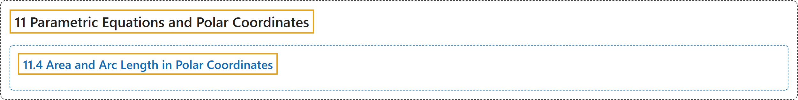

# 11.4 Area and Arc Length in Polar Coordinates

## Classification

## Glossary

| Term | Definition | 中文翻译 | Source |
|---|---|---|---|
| **11 Parametric Equations and Polar Coordinates** 参数方程与极坐标 | (No definition) | （无定义） | [Strang & Herman, 2016b, chapter 7](https://openstax.org/books/calculus-volume-2/pages/7-introduction) |
| **11.4 Area and Arc Length in Polar Coordinates** 极坐标下的面积与弧长 | (No definition) | （无定义） | [Strang & Herman, 2016b, section 7.4](https://openstax.org/books/calculus-volume-2/pages/7-4-area-and-arc-length-in-polar-coordinates) |

## References

Strang, G., & Herman, E. (2016b). *Calculus volume 2*. OpenStax. Retrieved October 29, 2026, from <https://openstax.org/details/books/calculus-volume-2>
