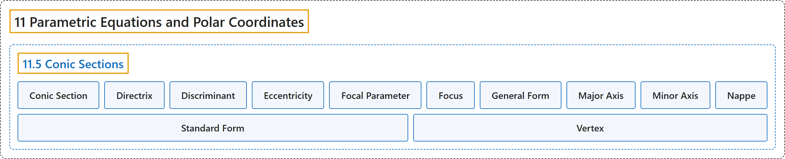

# 11.5 Conic Sections

## Classification

## Glossary

| Term | Definition | 中文翻译 | Source |
|---|---|---|---|
| **11 Parametric Equations and Polar Coordinates** 参数方程与极坐标 | (No definition) | （无定义） | [Strang & Herman, 2016b, chapter 7](https://openstax.org/books/calculus-volume-2/pages/7-introduction) |
| **11.5 Conic Sections** 圆锥曲线 | (No definition) | （无定义） | [Strang & Herman, 2016b, section 7.5](https://openstax.org/books/calculus-volume-2/pages/7-5-conic-sections) |
| **Conic Section** 圆锥曲线 | "a conic section is any curve formed by **the intersection of a plane with a cone of two nappes**" | 圆锥曲线是由**平面与两叶圆锥相交**所形成的任一曲线 | [Strang & Herman, 2016b, chapter 7 Key Terms](https://openstax.org/books/calculus-volume-2/pages/7-key-terms#fs-id1167794049400) |
| **Directrix** 准线 | "a directrix (plural: directrices) is **a line used to construct and define a conic section**; a parabola has one directrix; ellipses and hyperbolas have two" | 准线（复数：directrices）是**用来构造和定义圆锥曲线的直线**；抛物线有一条准线；椭圆和双曲线有两条 | [Strang & Herman, 2016b, chapter 7 Key Terms](https://openstax.org/books/calculus-volume-2/pages/7-key-terms#fs-id1167794049410) |
| **Discriminant** 判别式 | "the value $4AC-B^{2},$ which **is used to identify a conic** when the equation contains a term involving $xy,$ is called a discriminant" | 值 $4AC-B^{2},$ 在方程含 $xy,$ 项时**用来判别圆锥曲线**，称为判别式 | [Strang & Herman, 2016b, chapter 7 Key Terms](https://openstax.org/books/calculus-volume-2/pages/7-key-terms#fs-id1167794049421) |
| **Eccentricity** 离心率 | "the eccentricity is defined as the distance from any point on the conic section to its focus **divided by the perpendicular distance from that point to the nearest directrix**" | 离心率定义为圆锥曲线上任一点到焦点的距离**除以该点到最近准线的垂直距离** | [Strang & Herman, 2016b, chapter 7 Key Terms](https://openstax.org/books/calculus-volume-2/pages/7-key-terms#fs-id1167794049471) |
| **Focal Parameter** 焦参数 | "the focal parameter is **the distance from a focus of a conic section to the nearest directrix**" | 焦参数是**圆锥曲线的焦点到最近准线的距离** | [Strang & Herman, 2016b, chapter 7 Key Terms](https://openstax.org/books/calculus-volume-2/pages/7-key-terms#fs-id1167794049482) |
| **Focus** 焦点 | "a focus (plural: foci) is **a point used to construct and define a conic section**; a parabola has one focus; an ellipse and a hyperbola have two" | 焦点（复数：foci）是**用来构造和定义圆锥曲线的点**；抛物线有一个焦点；椭圆和双曲线有两个 | [Strang & Herman, 2016b, chapter 7 Key Terms](https://openstax.org/books/calculus-volume-2/pages/7-key-terms#fs-id1167794049460) |
| **General Form** 一般式 | "an equation of a conic section written as **a general second-degree equation**" | 写成**一般二次方程**的圆锥曲线方程 | [Strang & Herman, 2016b, chapter 7 Key Terms](https://openstax.org/books/calculus-volume-2/pages/7-key-terms#fs-id1167794049493) |
| **Major Axis** 长轴 | "the major axis of a conic section passes through the vertex in the case of a parabola or through the two vertices in the case of an ellipse or hyperbola; it is also **an axis of symmetry of the conic**; also called the transverse axis" | 圆锥曲线的长轴在抛物线情形下经过顶点，在椭圆或双曲线情形下经过两个顶点；它也是**圆锥曲线的对称轴**；也称为横轴 | [Strang & Herman, 2016b, chapter 7 Key Terms](https://openstax.org/books/calculus-volume-2/pages/7-key-terms#fs-id1167794049502) |
| **Minor Axis** 短轴 | "the minor axis is **perpendicular to the major axis** and intersects the major axis at the center of the conic, or at the vertex in the case of the parabola; also called the conjugate axis" | 短轴**垂直于长轴**，并在圆锥曲线的中心（抛物线情形下在顶点）与长轴相交；也称为共轭轴 | [Strang & Herman, 2016b, chapter 7 Key Terms](https://openstax.org/books/calculus-volume-2/pages/7-key-terms#fs-id1167794049514) |
| **Nappe** 叶 | "a nappe is **one half of a double cone**" | 叶是**双圆锥的一半** | [Strang & Herman, 2016b, chapter 7 Key Terms](https://openstax.org/books/calculus-volume-2/pages/7-key-terms#fs-id1167794049525) |
| **Standard Form** 标准式 | "an equation of a conic section **showing its properties**, such as location of the vertex or lengths of major and minor axes" | **表明其性质**（如顶点位置或长短轴长度）的圆锥曲线方程 | [Strang & Herman, 2016b, chapter 7 Key Terms](https://openstax.org/books/calculus-volume-2/pages/7-key-terms#fs-id1167794049535) |
| **Vertex** 顶点 | "a vertex is **an extreme point on a conic section**; a parabola has one vertex at its turning point. An ellipse has two vertices, one at each end of the major axis; a hyperbola has two vertices, one at the turning point of each branch" | 顶点是**圆锥曲线上的极端点**；抛物线在其转折点处有一个顶点。椭圆有两个顶点，长轴两端各一个；双曲线有两个顶点，每支的转折点各一个 | [Strang & Herman, 2016b, chapter 7 Key Terms](https://openstax.org/books/calculus-volume-2/pages/7-key-terms#fs-id1167794049546) |

## References

Strang, G., & Herman, E. (2016b). *Calculus volume 2*. OpenStax. Retrieved October 29, 2026, from <https://openstax.org/details/books/calculus-volume-2>
