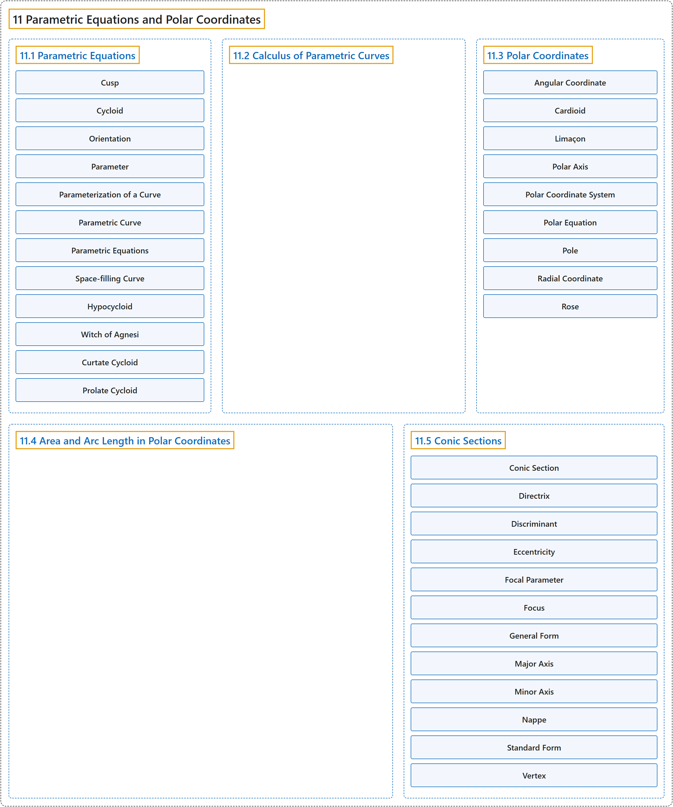

# 11 Parametric Equations and Polar Coordinates

## Classification

## Glossary

| Term | Definition | 中文翻译 | Source |
|---|---|---|---|
| **11 Parametric Equations and Polar Coordinates** 参数方程与极坐标 | (No definition) | （无定义） | [Strang & Herman, 2016b, chapter 7](https://openstax.org/books/calculus-volume-2/pages/7-introduction) |
| **[11.1 Parametric Equations](11-1-parametric-equations.md)** 参数方程 | (No definition) | （无定义） | [Strang & Herman, 2016b, section 7.1](https://openstax.org/books/calculus-volume-2/pages/7-1-parametric-equations) |
| **[11.2 Calculus of Parametric Curves](11-2-calculus-of-parametric-curves.md)** 参数曲线的微积分 | (No definition) | （无定义） | [Strang & Herman, 2016b, section 7.2](https://openstax.org/books/calculus-volume-2/pages/7-2-calculus-of-parametric-curves) |
| **[11.3 Polar Coordinates](11-3-polar-coordinates.md)** 极坐标 | (No definition) | （无定义） | [Strang & Herman, 2016b, section 7.3](https://openstax.org/books/calculus-volume-2/pages/7-3-polar-coordinates) |
| **[11.4 Area and Arc Length in Polar Coordinates](11-4-area-and-arc-length-in-polar-coordinates.md)** 极坐标下的面积与弧长 | (No definition) | （无定义） | [Strang & Herman, 2016b, section 7.4](https://openstax.org/books/calculus-volume-2/pages/7-4-area-and-arc-length-in-polar-coordinates) |
| **[11.5 Conic Sections](11-5-conic-sections.md)** 圆锥曲线 | (No definition) | （无定义） | [Strang & Herman, 2016b, section 7.5](https://openstax.org/books/calculus-volume-2/pages/7-5-conic-sections) |

## References

Strang, G., & Herman, E. (2016b). *Calculus volume 2*. OpenStax. Retrieved October 29, 2026, from <https://openstax.org/details/books/calculus-volume-2>
