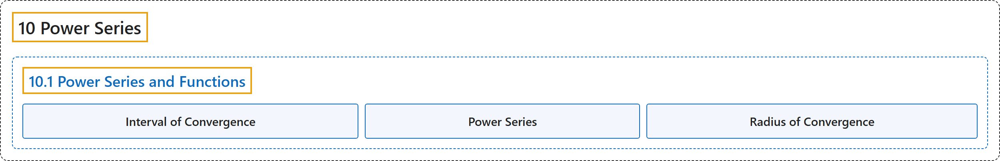

# 10.1 Power Series and Functions

## Classification

## Glossary

| Term | Definition | 中文翻译 | Source |
|---|---|---|---|
| **10 Power Series** 幂级数 | (No definition) | （无定义） | [Strang & Herman, 2016b, chapter 6](https://openstax.org/books/calculus-volume-2/pages/6-introduction) |
| **10.1 Power Series and Functions** 幂级数与函数 | (No definition) | （无定义） | [Strang & Herman, 2016b, section 6.1](https://openstax.org/books/calculus-volume-2/pages/6-1-power-series-and-functions) |
| **Interval of Convergence** 收敛区间 | "**the set of real numbers x** for which a power series converges" | 使幂级数收敛的**实数 x 的集合** | [Strang & Herman, 2016b, chapter 6 Key Terms](https://openstax.org/books/calculus-volume-2/pages/6-key-terms#fs-id1170571642075) |
| **Power Series** 幂级数 | "a series of the form $\sum_{n=0}^{\infty }c_{n}x^{n}$ **is a power series centered at** $x=0\text{;}$ a series of the form $\sum_{n=0}^{\infty }c_{n}(x-a)^{n}$ is a power series centered at $x=a$" | 形如 $\sum_{n=0}^{\infty }c_{n}x^{n}$ 的级数**是以 $x=0\text{;}$ 为中心的幂级数**；形如 $\sum_{n=0}^{\infty }c_{n}(x-a)^{n}$ 的级数是以 $x=a$ 为中心的幂级数 | [Strang & Herman, 2016b, chapter 6 Key Terms](https://openstax.org/books/calculus-volume-2/pages/6-key-terms#fs-id1170571642090) |
| **Radius of Convergence** 收敛半径 | "if there exists a real number $R>0$ such that a power series centered at $x=a$ converges for $\vert x-a\vert <R$ and diverges for $\vert x-a\vert >R,$ **then R is the radius of convergence**; if the power series only converges at $x=a,$ the radius of convergence is $R=0\text{;}$ if the power series converges for all real numbers x, the radius of convergence is $R=\infty$" | 若存在实数 $R>0$，使得以 $x=a$ 为中心的幂级数在 $\vert x-a\vert <R$ 时收敛、在 $\vert x-a\vert >R,$ 时发散，**则 R 是收敛半径**；若幂级数只在 $x=a,$ 收敛，收敛半径为 $R=0\text{;}$ 若幂级数对所有实数 x 收敛，收敛半径为 $R=\infty$ | [Strang & Herman, 2016b, chapter 6 Key Terms](https://openstax.org/books/calculus-volume-2/pages/6-key-terms#fs-id1170571674101) |

## References

Strang, G., & Herman, E. (2016b). *Calculus volume 2*. OpenStax. Retrieved October 29, 2026, from <https://openstax.org/details/books/calculus-volume-2>
