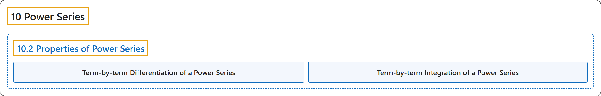

# 10.2 Properties of Power Series

## Classification

## Glossary

| Term | Definition | 中文翻译 | Source |
|---|---|---|---|
| **10 Power Series** 幂级数 | (No definition) | （无定义） | [Strang & Herman, 2016b, chapter 6](https://openstax.org/books/calculus-volume-2/pages/6-introduction) |
| **10.2 Properties of Power Series** 幂级数的性质 | (No definition) | （无定义） | [Strang & Herman, 2016b, section 6.2](https://openstax.org/books/calculus-volume-2/pages/6-2-properties-of-power-series) |
| **Term-by-term Differentiation of a Power Series** 幂级数的逐项求导 | "a technique for evaluating the derivative of a power series $\sum_{n=0}^{\infty }c_{n}(x-a)^{n}$ by **evaluating the derivative of each term separately** to create the new power series $\sum_{n=1}^{\infty }nc_{n}(x-a)^{n-1}$" | 求幂级数 $\sum_{n=0}^{\infty }c_{n}(x-a)^{n}$ 导数的一种方法：**分别求每一项的导数**，得到新的幂级数 $\sum_{n=1}^{\infty }nc_{n}(x-a)^{n-1}$ | [Strang & Herman, 2016b, chapter 6 Key Terms](https://openstax.org/books/calculus-volume-2/pages/6-key-terms#fs-id1167023915744) |
| **Term-by-term Integration of a Power Series** 幂级数的逐项积分 | "a technique for integrating a power series $\sum_{n=0}^{\infty }c_{n}(x-a)^{n}$ by **integrating each term separately** to create the new power series $C+\sum_{n=0}^{\infty }c_{n}\frac{(x-a)^{n+1}}{n+1}$" | 对幂级数 $\sum_{n=0}^{\infty }c_{n}(x-a)^{n}$ 积分的一种方法：**分别对每一项积分**，得到新的幂级数 $C+\sum_{n=0}^{\infty }c_{n}\frac{(x-a)^{n+1}}{n+1}$ | [Strang & Herman, 2016b, chapter 6 Key Terms](https://openstax.org/books/calculus-volume-2/pages/6-key-terms#fs-id1167023915846) |

## References

Strang, G., & Herman, E. (2016b). *Calculus volume 2*. OpenStax. Retrieved October 29, 2026, from <https://openstax.org/details/books/calculus-volume-2>
