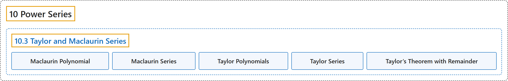

# 10.3 Taylor and Maclaurin Series

## Classification

## Glossary

| Term | Definition | 中文翻译 | Source |
|---|---|---|---|
| **10 Power Series** 幂级数 | (No definition) | （无定义） | [Strang & Herman, 2016b, chapter 6](https://openstax.org/books/calculus-volume-2/pages/6-introduction) |
| **10.3 Taylor and Maclaurin Series** 泰勒级数与麦克劳林级数 | (No definition) | （无定义） | [Strang & Herman, 2016b, section 6.3](https://openstax.org/books/calculus-volume-2/pages/6-3-taylor-and-maclaurin-series) |
| **Maclaurin Polynomial** 麦克劳林多项式 | "**a Taylor polynomial centered at 0**; the nth Taylor polynomial for $f$ at 0 is the nth Maclaurin polynomial for $f$" | **以 0 为中心的泰勒多项式**；$f$ 在 0 处的 n 阶泰勒多项式就是 $f$ 的 n 阶麦克劳林多项式 | [Strang & Herman, 2016b, chapter 6 Key Terms](https://openstax.org/books/calculus-volume-2/pages/6-key-terms#fs-id1167025150975) |
| **Maclaurin Series** 麦克劳林级数 | "a Taylor series for a function $f$ at $x=0$ **is known as a Maclaurin series** for $f$" | 函数 $f$ 在 $x=0$ 处的泰勒级数**称为 $f$ 的麦克劳林级数** | [Strang & Herman, 2016b, chapter 6 Key Terms](https://openstax.org/books/calculus-volume-2/pages/6-key-terms#fs-id1167025151005) |
| **Taylor Polynomials** 泰勒多项式 | "**the nth Taylor polynomial** for $f$ at $x=a$ is $p_{n}(x)=f(a)+f^{'}(a)(x-a)+\frac{f^{''}(a)}{2!}(x-a)^{2}+\cdots +\frac{f^{(n)}(a)}{n!}(x-a)^{n}$" | $f$ 在 $x=a$ 处的 **n 阶泰勒多项式**是 $p_{n}(x)=f(a)+f^{'}(a)(x-a)+\frac{f^{''}(a)}{2!}(x-a)^{2}+\cdots +\frac{f^{(n)}(a)}{n!}(x-a)^{n}$ | [Strang & Herman, 2016b, chapter 6 Key Terms](https://openstax.org/books/calculus-volume-2/pages/6-key-terms#fs-id1167025151035) |
| **Taylor Series** 泰勒级数 | "a power series at a that **converges to a function** $f$ on some open interval containing a" | 在 a 处的幂级数，在某个包含 a 的开区间上**收敛到函数** $f$ | [Strang & Herman, 2016b, chapter 6 Key Terms](https://openstax.org/books/calculus-volume-2/pages/6-key-terms#fs-id1167025001267) |
| **Taylor’s Theorem with Remainder** 带余项的泰勒定理 | "for a function $f$ and the nth Taylor polynomial for $f$ at $x=a,$ the remainder $R_{n}(x)=f(x)-p_{n}(x)$ satisfies $R_{n}(x)=\frac{f^{(n+1)}(c)}{(n+1)!}(x-a)^{n+1}$ **for some c between x and a**; if there exists an interval I containing a and a real number M such that $\vert f^{(n+1)}(x)\vert \le M$ for all x in I, then $\vert R_{n}(x)\vert \le \frac{M}{(n+1)!}{\vert x-a\vert }^{n+1}$" | 对函数 $f$ 及 $f$ 在 $x=a,$ 处的 n 阶泰勒多项式，余项 $R_{n}(x)=f(x)-p_{n}(x)$ 满足 $R_{n}(x)=\frac{f^{(n+1)}(c)}{(n+1)!}(x-a)^{n+1}$，**其中 c 是介于 x 与 a 之间的某个数**；若存在包含 a 的区间 I 和实数 M，使得对 I 中所有 x 有 $\vert f^{(n+1)}(x)\vert \le M$，则 $\vert R_{n}(x)\vert \le \frac{M}{(n+1)!}{\vert x-a\vert }^{n+1}$ | [Strang & Herman, 2016b, chapter 6 Key Terms](https://openstax.org/books/calculus-volume-2/pages/6-key-terms#fs-id1167025001291) |

## References

Strang, G., & Herman, E. (2016b). *Calculus volume 2*. OpenStax. Retrieved October 29, 2026, from <https://openstax.org/details/books/calculus-volume-2>
