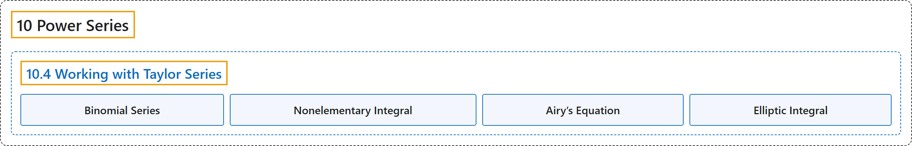

# 10.4 Working with Taylor Series

## Classification

## Glossary

| Term | Definition | 中文翻译 | Source |
|---|---|---|---|
| **10 Power Series** 幂级数 | (No definition) | （无定义） | [Strang & Herman, 2016b, chapter 6](https://openstax.org/books/calculus-volume-2/pages/6-introduction) |
| **10.4 Working with Taylor Series** 泰勒级数的运用 | (No definition) | （无定义） | [Strang & Herman, 2016b, section 6.4](https://openstax.org/books/calculus-volume-2/pages/6-4-working-with-taylor-series) |
| **Binomial Series** 二项式级数 | "**the Maclaurin series for** $f(x)=(1+x)^{r};$ it is given by $(1+x)^{r}=\sum_{n=0}^{\infty }\binom{r}{n}x^{n}=1+rx+\frac{r(r-1)}{2!}x^{2}+\cdots +\frac{r(r-1)\cdots (r-n+1)}{n!}x^{n}+\cdots$ for $\vert x\vert <1$" | $f(x)=(1+x)^{r};$ **的麦克劳林级数**；它由 $(1+x)^{r}=\sum_{n=0}^{\infty }\binom{r}{n}x^{n}=1+rx+\frac{r(r-1)}{2!}x^{2}+\cdots +\frac{r(r-1)\cdots (r-n+1)}{n!}x^{n}+\cdots$ 给出，适用于 $\vert x\vert <1$ | [Strang & Herman, 2016b, chapter 6 Key Terms](https://openstax.org/books/calculus-volume-2/pages/6-key-terms#fs-id1167023846563) |
| **Nonelementary Integral** 非初等积分 | "an integral for which the antiderivative of the integrand **cannot be expressed as an elementary function**" | 被积函数的原函数**不能表示为初等函数**的积分 | [Strang & Herman, 2016b, chapter 6 Key Terms](https://openstax.org/books/calculus-volume-2/pages/6-key-terms#fs-id1167023864772) |
| **Airy’s Equation** 艾里方程 | "is known as **Airy’s equation**." | 称为**艾里方程**。 | [Strang & Herman, 2016b, section 6.4](https://openstax.org/books/calculus-volume-2/pages/6-4-working-with-taylor-series#term-00002) |
| **Elliptic Integral** 椭圆积分 | "An integral of this form is known as **an elliptic integral of the first kind**." | 这种形式的积分称为**第一类椭圆积分**。 | [Strang & Herman, 2016b, section 6.4](https://openstax.org/books/calculus-volume-2/pages/6-4-working-with-taylor-series#term-00004) |

## References

Strang, G., & Herman, E. (2016b). *Calculus volume 2*. OpenStax. Retrieved October 29, 2026, from <https://openstax.org/details/books/calculus-volume-2>
