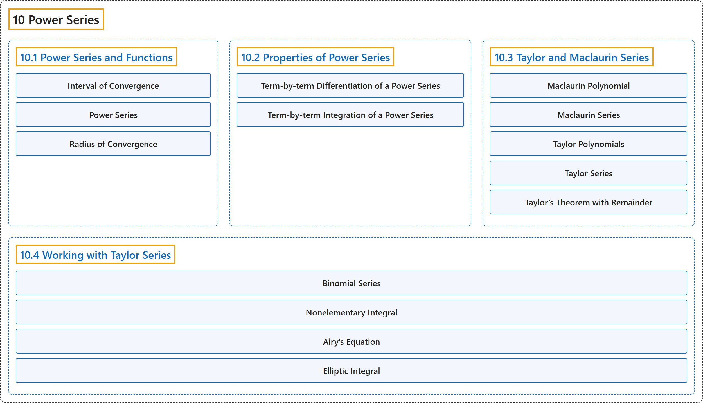

# 10 Power Series

## Classification

## Glossary

| Term | Definition | 中文翻译 | Source |
|---|---|---|---|
| **10 Power Series** 幂级数 | (No definition) | （无定义） | [Strang & Herman, 2016b, chapter 6](https://openstax.org/books/calculus-volume-2/pages/6-introduction) |
| **[10.1 Power Series and Functions](10-1-power-series-and-functions.md)** 幂级数与函数 | (No definition) | （无定义） | [Strang & Herman, 2016b, section 6.1](https://openstax.org/books/calculus-volume-2/pages/6-1-power-series-and-functions) |
| **[10.2 Properties of Power Series](10-2-properties-of-power-series.md)** 幂级数的性质 | (No definition) | （无定义） | [Strang & Herman, 2016b, section 6.2](https://openstax.org/books/calculus-volume-2/pages/6-2-properties-of-power-series) |
| **[10.3 Taylor and Maclaurin Series](10-3-taylor-and-maclaurin-series.md)** 泰勒级数与麦克劳林级数 | (No definition) | （无定义） | [Strang & Herman, 2016b, section 6.3](https://openstax.org/books/calculus-volume-2/pages/6-3-taylor-and-maclaurin-series) |
| **[10.4 Working with Taylor Series](10-4-working-with-taylor-series.md)** 泰勒级数的运用 | (No definition) | （无定义） | [Strang & Herman, 2016b, section 6.4](https://openstax.org/books/calculus-volume-2/pages/6-4-working-with-taylor-series) |

## References

Strang, G., & Herman, E. (2016b). *Calculus volume 2*. OpenStax. Retrieved October 29, 2026, from <https://openstax.org/details/books/calculus-volume-2>
