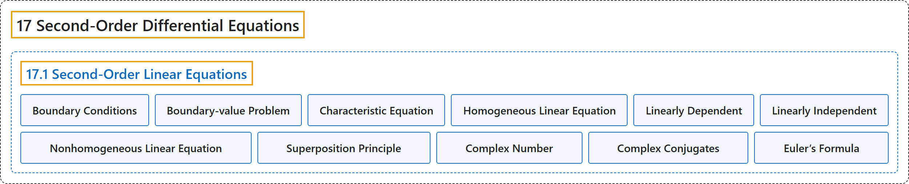

# 17.1 Second-Order Linear Equations

## Classification

## Glossary

| Term | Definition | 中文翻译 | Source |
|---|---|---|---|
| **17 Second-Order Differential Equations** 二阶微分方程 | (No definition) | （无定义） | [Strang & Herman, 2016c, chapter 7](https://openstax.org/books/calculus-volume-3/pages/7-introduction) |
| **17.1 Second-Order Linear Equations** 二阶线性方程 | (No definition) | （无定义） | [Strang & Herman, 2016c, section 7.1](https://openstax.org/books/calculus-volume-3/pages/7-1-second-order-linear-equations) |
| **Boundary Conditions** 边界条件 | "the conditions that give **the state of a system at different times**, such as the position of a spring-mass system at two different times" | 给出**系统在不同时刻的状态**的条件，例如弹簧质量系统在两个不同时刻的位置 | [Strang & Herman, 2016c, chapter 7 Key Terms](https://openstax.org/books/calculus-volume-3/pages/7-key-terms#fs-id1170572622374) |
| **Boundary-value Problem** 边值问题 | "a differential equation **with associated boundary conditions**" | **带有相应边界条件**的微分方程 | [Strang & Herman, 2016c, chapter 7 Key Terms](https://openstax.org/books/calculus-volume-3/pages/7-key-terms#fs-id1170572626673) |
| **Characteristic Equation** 特征方程 | "the equation $a{\lambda }^{2}+b\lambda +c=0$ **for the differential equation** $ay^{''}+by^{'}+cy=0$" | **对微分方程** $ay^{''}+by^{'}+cy=0$ 的方程 $a{\lambda }^{2}+b\lambda +c=0$ | [Strang & Herman, 2016c, chapter 7 Key Terms](https://openstax.org/books/calculus-volume-3/pages/7-key-terms#fs-id1170572626683) |
| **Homogeneous Linear Equation** 齐次线性方程 | "a second-order differential equation that can be written in the form $a_{2}(x)y^{''}+a_{1}(x)y^{'}+a_{0}(x)y=r(x),$ but $r(x)=0$ **for every value of** $x$" | 可以写成 $a_{2}(x)y^{''}+a_{1}(x)y^{'}+a_{0}(x)y=r(x),$ 形式、但**对 $x$ 的每个值**都有 $r(x)=0$ 的二阶微分方程 | [Strang & Herman, 2016c, chapter 7 Key Terms](https://openstax.org/books/calculus-volume-3/pages/7-key-terms#fs-id1170572626748) |
| **Linearly Dependent** 线性相关 | "a set of functions $f_{1}(x),f_{2}(x),\ldots ,f_{n}(x)$ for which there are constants $c_{1},c_{2},\ldots c_{n},$ **not all zero**, such that $c_{1}f_{1}(x)+c_{2}f_{2}(x)+\cdots +c_{n}f_{n}(x)=0$ for all x in the interval of interest" | 一组函数 $f_{1}(x),f_{2}(x),\ldots ,f_{n}(x)$，存在**不全为零**的常数 $c_{1},c_{2},\ldots c_{n},$ 使得对所关心区间内的所有 x 有 $c_{1}f_{1}(x)+c_{2}f_{2}(x)+\cdots +c_{n}f_{n}(x)=0$ | [Strang & Herman, 2016c, chapter 7 Key Terms](https://openstax.org/books/calculus-volume-3/pages/7-key-terms#fs-id1170572370443) |
| **Linearly Independent** 线性无关 | "a set of functions $f_{1}(x),f_{2}(x),\ldots ,f_{n}(x)$ for which **there are no constants** $c_{1},c_{2},\ldots c_{n},$ such that $c_{1}f_{1}(x)+c_{2}f_{2}(x)+\cdots +c_{n}f_{n}(x)=0$ for all x in the interval of interest" | 一组函数 $f_{1}(x),f_{2}(x),\ldots ,f_{n}(x)$，**不存在常数** $c_{1},c_{2},\ldots c_{n},$ 使得对所关心区间内的所有 x 有 $c_{1}f_{1}(x)+c_{2}f_{2}(x)+\cdots +c_{n}f_{n}(x)=0$ | [Strang & Herman, 2016c, chapter 7 Key Terms](https://openstax.org/books/calculus-volume-3/pages/7-key-terms#fs-id1170571683582) |
| **Nonhomogeneous Linear Equation** 非齐次线性方程 | "a second-order differential equation that can be written in the form $a_{2}(x)y^{''}+a_{1}(x)y^{'}+a_{0}(x)y=r(x),$ but $r(x)\ne 0$ **for some value of** $x$" | 可以写成 $a_{2}(x)y^{''}+a_{1}(x)y^{'}+a_{0}(x)y=r(x),$ 形式、但**对 $x$ 的某个值**有 $r(x)\ne 0$ 的二阶微分方程 | [Strang & Herman, 2016c, chapter 7 Key Terms](https://openstax.org/books/calculus-volume-3/pages/7-key-terms#fs-id1170572250119) |
| **Superposition Principle** 叠加原理 | "The proof of this **superposition principle** theorem is left as an exercise." | 这个**叠加原理**定理的证明留作练习。 | [Strang & Herman, 2016c, section 7.1](https://openstax.org/books/calculus-volume-3/pages/7-1-second-order-linear-equations#term-00003) |
| **Complex Number** 复数 | "**The complex number** $\alpha +\beta i$ is called the conjugate of $\alpha -\beta i\text{.}$" | **复数** $\alpha +\beta i$ 称为 $\alpha -\beta i$ 的共轭。 | [Strang & Herman, 2016c, section 7.1](https://openstax.org/books/calculus-volume-3/pages/7-1-second-order-linear-equations#term-00008) |
| **Complex Conjugates** 共轭复数 | "Thus, we see that when $b^{2}-4ac<0,$ the roots of our characteristic equation are always **complex conjugates**." | 因此我们看到，当 $b^{2}-4ac<0,$ 时，特征方程的根总是**共轭复数**。 | [Strang & Herman, 2016c, section 7.1](https://openstax.org/books/calculus-volume-3/pages/7-1-second-order-linear-equations#term-00009) |
| **Euler’s Formula** 欧拉公式 | "One of the key tools we used to express these exponential functions in terms of sines and cosines was **Euler’s formula**, which tells us that" | 我们用来把这些指数函数用正弦和余弦表示的关键工具之一是**欧拉公式**，它告诉我们 | [Strang & Herman, 2016c, section 7.1](https://openstax.org/books/calculus-volume-3/pages/7-1-second-order-linear-equations#term-00010) |

## References

Strang, G., & Herman, E. (2016c). *Calculus volume 3*. OpenStax. Retrieved October 29, 2026, from <https://openstax.org/details/books/calculus-volume-3>
