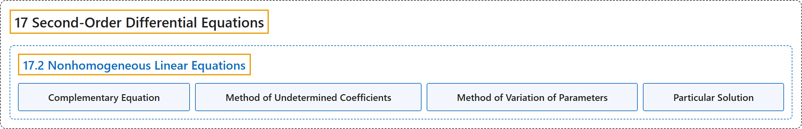

# 17.2 Nonhomogeneous Linear Equations

## Classification

## Glossary

| Term | Definition | 中文翻译 | Source |
|---|---|---|---|
| **17 Second-Order Differential Equations** 二阶微分方程 | (No definition) | （无定义） | [Strang & Herman, 2016c, chapter 7](https://openstax.org/books/calculus-volume-3/pages/7-introduction) |
| **17.2 Nonhomogeneous Linear Equations** 非齐次线性方程 | (No definition) | （无定义） | [Strang & Herman, 2016c, section 7.2](https://openstax.org/books/calculus-volume-3/pages/7-2-nonhomogeneous-linear-equations) |
| **Complementary Equation** 余方程 | "for the nonhomogeneous linear differential equation $a_{2}(x)y^{''}+a_{1}(x)y^{'}+a_{0}(x)y=r(x),$ the associated homogeneous equation, called **the complementary equation**, is $a_{2}(x)y^{''}+a_{1}(x)y^{'}+a_{0}(x)y=0$" | 对非齐次线性微分方程 $a_{2}(x)y^{''}+a_{1}(x)y^{'}+a_{0}(x)y=r(x),$ 相应的齐次方程称为**余方程**，即 $a_{2}(x)y^{''}+a_{1}(x)y^{'}+a_{0}(x)y=0$ | [Strang & Herman, 2016c, chapter 7 Key Terms](https://openstax.org/books/calculus-volume-3/pages/7-key-terms#fs-id1170572626500) |
| **Method of Undetermined Coefficients** 待定系数法 | "a method that involves **making a guess about the form of the particular solution**, then solving for the coefficients in the guess" | 一种方法：**对特解的形式作猜测**，再解出猜测中的系数 | [Strang & Herman, 2016c, chapter 7 Key Terms](https://openstax.org/books/calculus-volume-3/pages/7-key-terms#fs-id1170572557991) |
| **Method of Variation of Parameters** 参数变易法 | "a method that involves **looking for particular solutions in the form** $y_{p}(x)=u(x)y_{1}(x)+v(x)y_{2}(x),$ where $y_{1}$ and $y_{2}$ are linearly independent solutions to the complementary equations, and then solving a system of equations to find $u(x)$ and $v(x)$" | 一种方法：**寻找形如 $y_{p}(x)=u(x)y_{1}(x)+v(x)y_{2}(x),$ 的特解**，其中 $y_{1}$ 和 $y_{2}$ 是余方程的线性无关解，再解方程组求出 $u(x)$ 和 $v(x)$ | [Strang & Herman, 2016c, chapter 7 Key Terms](https://openstax.org/books/calculus-volume-3/pages/7-key-terms#fs-id1170572558002) |
| **Particular Solution** 特解 | "a solution $y_{p}(x)$ of a differential equation that **contains no arbitrary constants**" | 微分方程的一个**不含任意常数**的解 $y_{p}(x)$ | [Strang & Herman, 2016c, chapter 7 Key Terms](https://openstax.org/books/calculus-volume-3/pages/7-key-terms#fs-id1170571790278) |

## References

Strang, G., & Herman, E. (2016c). *Calculus volume 3*. OpenStax. Retrieved October 29, 2026, from <https://openstax.org/details/books/calculus-volume-3>
