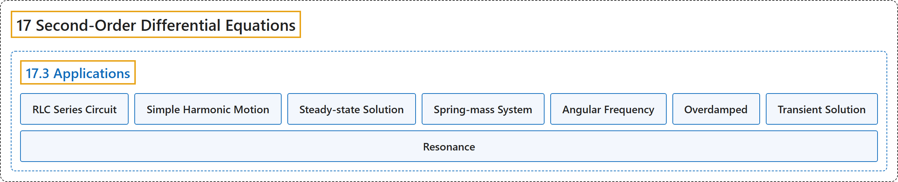

# 17.3 Applications

## Classification

## Glossary

| Term | Definition | 中文翻译 | Source |
|---|---|---|---|
| **17 Second-Order Differential Equations** 二阶微分方程 | (No definition) | （无定义） | [Strang & Herman, 2016c, chapter 7](https://openstax.org/books/calculus-volume-3/pages/7-introduction) |
| **17.3 Applications** 应用 | (No definition) | （无定义） | [Strang & Herman, 2016c, section 7.3](https://openstax.org/books/calculus-volume-3/pages/7-3-applications) |
| **RLC Series Circuit** RLC 串联电路 | "a complete electrical path consisting of **a resistor, an inductor, and a capacitor**; a second-order, constant-coefficient differential equation can be used to model the charge on the capacitor in an RLC series circuit" | 由**电阻、电感和电容**组成的完整电路；可以用二阶常系数微分方程模拟 RLC 串联电路中电容上的电荷 | [Strang & Herman, 2016c, chapter 7 Key Terms](https://openstax.org/books/calculus-volume-3/pages/7-key-terms#fs-id1170571169932) |
| **Simple Harmonic Motion** 简谐运动 | "motion described by the equation $x(t)=c_{1}\cos \,(\omega t)+c_{2}\sin \,(\omega t),$ as exhibited by an undamped spring-mass system in which **the mass continues to oscillate indefinitely**" | 由方程 $x(t)=c_{1}\cos \,(\omega t)+c_{2}\sin \,(\omega t),$ 描述的运动，表现为无阻尼弹簧质量系统中**质量无限期地持续振动** | [Strang & Herman, 2016c, chapter 7 Key Terms](https://openstax.org/books/calculus-volume-3/pages/7-key-terms#fs-id1170571422515) |
| **Steady-state Solution** 稳态解 | "a solution to a nonhomogeneous differential equation **related to the forcing function**; in the long term, the solution approaches the steady-state solution" | 非齐次微分方程**与强迫函数相关**的解；从长期看，解趋近稳态解 | [Strang & Herman, 2016c, chapter 7 Key Terms](https://openstax.org/books/calculus-volume-3/pages/7-key-terms#fs-id1170573544065) |
| **Spring-mass System** 弹簧质量系统 | "(This is commonly called **a spring-mass system**.)" | （这通常称为**弹簧质量系统**。） | [Strang & Herman, 2016c, section 7.3](https://openstax.org/books/calculus-volume-3/pages/7-3-applications#term-00001) |
| **Angular Frequency** 角频率 | "It is convenient to rearrange this equation and introduce a new variable, called **the angular frequency**, $\omega \text{.}$" | 把这个方程重新整理并引入一个新变量会很方便，这个变量称为**角频率** $\omega$。 | [Strang & Herman, 2016c, section 7.3](https://openstax.org/books/calculus-volume-3/pages/7-3-applications#term-00003) |
| **Overdamped** 过阻尼 | "In this case, we say **the system is overdamped**." | 在这种情况下，我们说**系统是过阻尼的**。 | [Strang & Herman, 2016c, section 7.3](https://openstax.org/books/calculus-volume-3/pages/7-3-applications#term-00005) |
| **Transient Solution** 暂态解 | "Since these terms do not affect the long-term behavior of the system, we call this part of the solution **the transient solution**." | 由于这些项不影响系统的长期行为，我们把解的这一部分称为**暂态解**。 | [Strang & Herman, 2016c, section 7.3](https://openstax.org/books/calculus-volume-3/pages/7-3-applications#term-00006) |
| **Resonance** 共振 | "If an external force acting on the system has a frequency close to the natural frequency of the system, **a phenomenon called resonance results**." | 如果作用于系统的外力频率接近系统的固有频率，就会**产生一种称为共振的现象**。 | [Strang & Herman, 2016c, section 7.3](https://openstax.org/books/calculus-volume-3/pages/7-3-applications#term-00008) |

## References

Strang, G., & Herman, E. (2016c). *Calculus volume 3*. OpenStax. Retrieved October 29, 2026, from <https://openstax.org/details/books/calculus-volume-3>
