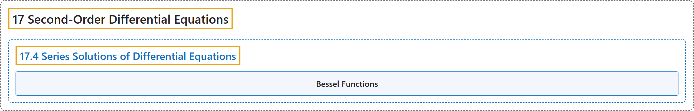

# 17.4 Series Solutions of Differential Equations

## Classification

## Glossary

| Term | Definition | 中文翻译 | Source |
|---|---|---|---|
| **17 Second-Order Differential Equations** 二阶微分方程 | (No definition) | （无定义） | [Strang & Herman, 2016c, chapter 7](https://openstax.org/books/calculus-volume-3/pages/7-introduction) |
| **17.4 Series Solutions of Differential Equations** 微分方程的级数解 | (No definition) | （无定义） | [Strang & Herman, 2016c, section 7.4](https://openstax.org/books/calculus-volume-3/pages/7-4-series-solutions-of-differential-equations) |
| **Bessel Functions** 贝塞尔函数 | "We close this section with a brief introduction to **Bessel functions**." | 我们以对**贝塞尔函数**的简要介绍结束本节。 | [Strang & Herman, 2016c, section 7.4](https://openstax.org/books/calculus-volume-3/pages/7-4-series-solutions-of-differential-equations#term-00002) |

## References

Strang, G., & Herman, E. (2016c). *Calculus volume 3*. OpenStax. Retrieved October 29, 2026, from <https://openstax.org/details/books/calculus-volume-3>
