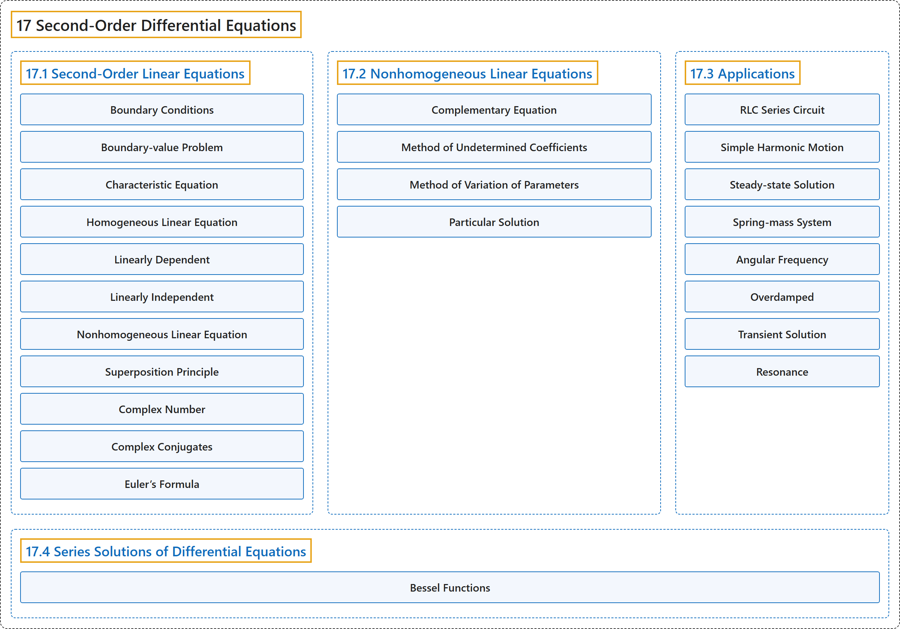

# 17 Second-Order Differential Equations

## Classification

## Glossary

| Term | Definition | 中文翻译 | Source |
|---|---|---|---|
| **17 Second-Order Differential Equations** 二阶微分方程 | (No definition) | （无定义） | [Strang & Herman, 2016c, chapter 7](https://openstax.org/books/calculus-volume-3/pages/7-introduction) |
| **[17.1 Second-Order Linear Equations](17-1-second-order-linear-equations.md)** 二阶线性方程 | (No definition) | （无定义） | [Strang & Herman, 2016c, section 7.1](https://openstax.org/books/calculus-volume-3/pages/7-1-second-order-linear-equations) |
| **[17.2 Nonhomogeneous Linear Equations](17-2-nonhomogeneous-linear-equations.md)** 非齐次线性方程 | (No definition) | （无定义） | [Strang & Herman, 2016c, section 7.2](https://openstax.org/books/calculus-volume-3/pages/7-2-nonhomogeneous-linear-equations) |
| **[17.3 Applications](17-3-applications.md)** 应用 | (No definition) | （无定义） | [Strang & Herman, 2016c, section 7.3](https://openstax.org/books/calculus-volume-3/pages/7-3-applications) |
| **[17.4 Series Solutions of Differential Equations](17-4-series-solutions-of-differential-equations.md)** 微分方程的级数解 | (No definition) | （无定义） | [Strang & Herman, 2016c, section 7.4](https://openstax.org/books/calculus-volume-3/pages/7-4-series-solutions-of-differential-equations) |

## References

Strang, G., & Herman, E. (2016c). *Calculus volume 3*. OpenStax. Retrieved October 29, 2026, from <https://openstax.org/details/books/calculus-volume-3>
