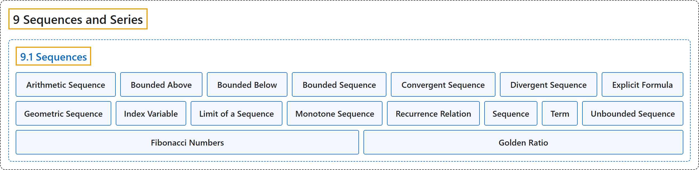

# 9.1 Sequences

## Classification

## Glossary

| Term | Definition | 中文翻译 | Source |
|---|---|---|---|
| **9 Sequences and Series** 数列与级数 | (No definition) | （无定义） | [Strang & Herman, 2016b, chapter 5](https://openstax.org/books/calculus-volume-2/pages/5-introduction) |
| **9.1 Sequences** 数列 | (No definition) | （无定义） | [Strang & Herman, 2016b, section 5.1](https://openstax.org/books/calculus-volume-2/pages/5-1-sequences) |
| **Arithmetic Sequence** 等差数列 | "a sequence in which **the difference between every pair of consecutive terms is the same** is called an arithmetic sequence" | **每对相邻项之差都相同**的数列称为等差数列 | [Strang & Herman, 2016b, chapter 5 Key Terms](https://openstax.org/books/calculus-volume-2/pages/5-key-terms#fs-id1169739249448) |
| **Bounded Above** 有上界 | "a sequence $\{a_{n}\}$ is bounded above if there exists a constant $M$ such that $a_{n}\le M$ **for all positive integers** $n$" | 数列 $\{a_{n}\}$ 有上界，如果存在常数 $M$ 使得**对所有正整数** $n$ 都有 $a_{n}\le M$ | [Strang & Herman, 2016b, chapter 5 Key Terms](https://openstax.org/books/calculus-volume-2/pages/5-key-terms#fs-id1169739249458) |
| **Bounded Below** 有下界 | "a sequence $\{a_{n}\}$ is bounded below if there exists a constant $M$ such that $M\le a_{n}$ **for all positive integers** $n$" | 数列 $\{a_{n}\}$ 有下界，如果存在常数 $M$ 使得**对所有正整数** $n$ 都有 $M\le a_{n}$ | [Strang & Herman, 2016b, chapter 5 Key Terms](https://openstax.org/books/calculus-volume-2/pages/5-key-terms#fs-id1169739249504) |
| **Bounded Sequence** 有界数列 | "a sequence $\{a_{n}\}$ is bounded if there exists a constant $M$ such that $\vert a_{n}\vert \le M$ **for all positive integers** $n$" | 数列 $\{a_{n}\}$ 有界，如果存在常数 $M$ 使得**对所有正整数** $n$ 都有 $\vert a_{n}\vert \le M$ | [Strang & Herman, 2016b, chapter 5 Key Terms](https://openstax.org/books/calculus-volume-2/pages/5-key-terms#fs-id1169739249549) |
| **Convergent Sequence** 收敛数列 | "a convergent sequence is a sequence $\{a_{n}\}$ for which there exists a real number $L$ such that $a_{n}$ **is arbitrarily close to** $L$ as long as $n$ is sufficiently large" | 收敛数列是这样的数列 $\{a_{n}\}$：存在实数 $L$，使得只要 $n$ 足够大，$a_{n}$ 就**任意接近** $L$ | [Strang & Herman, 2016b, chapter 5 Key Terms](https://openstax.org/books/calculus-volume-2/pages/5-key-terms#fs-id1169739249599) |
| **Divergent Sequence** 发散数列 | "a sequence that is **not convergent** is divergent" | **不收敛**的数列是发散的 | [Strang & Herman, 2016b, chapter 5 Key Terms](https://openstax.org/books/calculus-volume-2/pages/5-key-terms#fs-id1169739249646) |
| **Explicit Formula** 显式公式 | "a sequence may be defined by **an explicit formula** such that $a_{n}=f(n)$" | 数列可以由**显式公式**定义，使得 $a_{n}=f(n)$ | [Strang & Herman, 2016b, chapter 5 Key Terms](https://openstax.org/books/calculus-volume-2/pages/5-key-terms#fs-id1169736702613) |
| **Geometric Sequence** 等比数列 | "a sequence $\{a_{n}\}$ in which the ratio $a_{n+1}/a_{n}$ **is the same for all positive integers** $n$ is called a geometric sequence" | 比值 $a_{n+1}/a_{n}$ **对所有正整数 $n$ 都相同**的数列 $\{a_{n}\}$ 称为等比数列 | [Strang & Herman, 2016b, chapter 5 Key Terms](https://openstax.org/books/calculus-volume-2/pages/5-key-terms#fs-id1169736702642) |
| **Index Variable** 指标变量 | "**the subscript used to define the terms in a sequence** is called the index" | **用来定义数列各项的下标**称为指标 | [Strang & Herman, 2016b, chapter 5 Key Terms](https://openstax.org/books/calculus-volume-2/pages/5-key-terms#fs-id1169736702692) |
| **Limit of a Sequence** 数列的极限 | "the real number $L$ **to which a sequence converges** is called the limit of the sequence" | 数列**所收敛到的**实数 $L$ 称为数列的极限 | [Strang & Herman, 2016b, chapter 5 Key Terms](https://openstax.org/books/calculus-volume-2/pages/5-key-terms#fs-id1169736702702) |
| **Monotone Sequence** 单调数列 | "**an increasing or decreasing sequence**" | **递增或递减的数列** | [Strang & Herman, 2016b, chapter 5 Key Terms](https://openstax.org/books/calculus-volume-2/pages/5-key-terms#fs-id1169736702717) |
| **Recurrence Relation** 递推关系 | "a recurrence relation is a relationship in which a term $a_{n}$ in a sequence is **defined in terms of earlier terms in the sequence**" | 递推关系是这样一种关系：数列中的项 $a_{n}$ **用数列中前面的项来定义** | [Strang & Herman, 2016b, chapter 5 Key Terms](https://openstax.org/books/calculus-volume-2/pages/5-key-terms#fs-id1169736702727) |
| **Sequence** 数列 | "**an ordered list of numbers** of the form $a_{1},a_{2},a_{3},\ldots$ is a sequence" | 形如 $a_{1},a_{2},a_{3},\ldots$ 的**有序数列表**是数列 | [Strang & Herman, 2016b, chapter 5 Key Terms](https://openstax.org/books/calculus-volume-2/pages/5-key-terms#fs-id1169736702745) |
| **Term** 项 | "**the number** $a_{n}$ in the sequence $\{a_{n}\}$ is called the $n\text{th}$ term of the sequence" | 数列 $\{a_{n}\}$ 中的**数** $a_{n}$ 称为数列的第 $n\text{th}$ 项 | [Strang & Herman, 2016b, chapter 5 Key Terms](https://openstax.org/books/calculus-volume-2/pages/5-key-terms#fs-id1169736702783) |
| **Unbounded Sequence** 无界数列 | "a sequence that is **not bounded** is called unbounded" | **无界**的数列称为无界数列 | [Strang & Herman, 2016b, chapter 5 Key Terms](https://openstax.org/books/calculus-volume-2/pages/5-key-terms#fs-id1169736634909) |
| **Fibonacci Numbers** 斐波那契数 | "The Fibonacci numbers are **defined recursively** by the sequence $\{F_{n}\}$ where $F_{0}=0,$ $F_{1}=1$ and for $n\ge 2,$" | 斐波那契数由数列 $\{F_{n}\}$ **递归定义**，其中 $F_{0}=0,$ $F_{1}=1$，并且对 $n\ge 2,$ | [Strang & Herman, 2016b, section 5.1](https://openstax.org/books/calculus-volume-2/pages/5-1-sequences#term-00017) |
| **Golden Ratio** 黄金比 | "The number $\phi =(1+\sqrt{5})/2$ is known as **the golden ratio** (Figure 5.8 and Figure 5.9)." | 数 $\phi =(1+\sqrt{5})/2$ 称为**黄金比**（图 5.8 和图 5.9）。 | [Strang & Herman, 2016b, section 5.1](https://openstax.org/books/calculus-volume-2/pages/5-1-sequences#term-00018) |

## References

Strang, G., & Herman, E. (2016b). *Calculus volume 2*. OpenStax. Retrieved October 29, 2026, from <https://openstax.org/details/books/calculus-volume-2>
