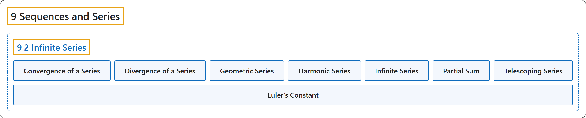

# 9.2 Infinite Series

## Classification

## Glossary

| Term | Definition | 中文翻译 | Source |
|---|---|---|---|
| **9 Sequences and Series** 数列与级数 | (No definition) | （无定义） | [Strang & Herman, 2016b, chapter 5](https://openstax.org/books/calculus-volume-2/pages/5-introduction) |
| **9.2 Infinite Series** 无穷级数 | (No definition) | （无定义） | [Strang & Herman, 2016b, section 5.2](https://openstax.org/books/calculus-volume-2/pages/5-2-infinite-series) |
| **Convergence of a Series** 级数的收敛 | "a series converges if **the sequence of partial sums for that series converges**" | 如果**级数的部分和数列收敛**，级数就收敛 | [Strang & Herman, 2016b, chapter 5 Key Terms](https://openstax.org/books/calculus-volume-2/pages/5-key-terms#fs-id1169737160426) |
| **Divergence of a Series** 级数的发散 | "a series diverges if **the sequence of partial sums for that series diverges**" | 如果**级数的部分和数列发散**，级数就发散 | [Strang & Herman, 2016b, chapter 5 Key Terms](https://openstax.org/books/calculus-volume-2/pages/5-key-terms#fs-id1169737160435) |
| **Geometric Series** 几何级数 | "a geometric series is a series that **can be written in the form** $\sum_{n=1}^{\infty }ar^{n-1}=a+ar+ar^{2}+ar^{3}+\cdots$" | 几何级数是**可以写成 $\sum_{n=1}^{\infty }ar^{n-1}=a+ar+ar^{2}+ar^{3}+\cdots$ 形式**的级数 | [Strang & Herman, 2016b, chapter 5 Key Terms](https://openstax.org/books/calculus-volume-2/pages/5-key-terms#fs-id1169737160445) |
| **Harmonic Series** 调和级数 | "the harmonic series **takes the form** $\sum_{n=1}^{\infty }\frac{1}{n}=1+\frac{1}{2}+\frac{1}{3}+\cdots$" | 调和级数**具有形式** $\sum_{n=1}^{\infty }\frac{1}{n}=1+\frac{1}{2}+\frac{1}{3}+\cdots$ | [Strang & Herman, 2016b, chapter 5 Key Terms](https://openstax.org/books/calculus-volume-2/pages/5-key-terms#fs-id1169738078130) |
| **Infinite Series** 无穷级数 | "an infinite series is **an expression of the form** $a_{1}+a_{2}+a_{3}+\cdots =\sum_{n=1}^{\infty }a_{n}$" | 无穷级数是**形如 $a_{1}+a_{2}+a_{3}+\cdots =\sum_{n=1}^{\infty }a_{n}$ 的表达式** | [Strang & Herman, 2016b, chapter 5 Key Terms](https://openstax.org/books/calculus-volume-2/pages/5-key-terms#fs-id1169738078190) |
| **Partial Sum** 部分和 | "the $k\text{th}$ partial sum of the infinite series $\sum_{n=1}^{\infty }a_{n}$ **is the finite sum** $S_{k}=\sum_{n=1}^{k}a_{n}=a_{1}+a_{2}+a_{3}+\cdots +a_{k}$" | 无穷级数 $\sum_{n=1}^{\infty }a_{n}$ 的第 $k\text{th}$ 个部分和**是有限和** $S_{k}=\sum_{n=1}^{k}a_{n}=a_{1}+a_{2}+a_{3}+\cdots +a_{k}$ | [Strang & Herman, 2016b, chapter 5 Key Terms](https://openstax.org/books/calculus-volume-2/pages/5-key-terms#fs-id1169738078254) |
| **Telescoping Series** 裂项级数 | "a telescoping series is one in which **most of the terms cancel** in each of the partial sums" | 裂项级数是在每个部分和中**大多数项相互抵消**的级数 | [Strang & Herman, 2016b, chapter 5 Key Terms](https://openstax.org/books/calculus-volume-2/pages/5-key-terms#fs-id1169738249026) |
| **Euler’s Constant** 欧拉常数 | "This constant $\gamma$ is known as **Euler’s constant**." | 这个常数 $\gamma$ 称为**欧拉常数**。 | [Strang & Herman, 2016b, section 5.2](https://openstax.org/books/calculus-volume-2/pages/5-2-infinite-series#term-00009) |

## References

Strang, G., & Herman, E. (2016b). *Calculus volume 2*. OpenStax. Retrieved October 29, 2026, from <https://openstax.org/details/books/calculus-volume-2>
