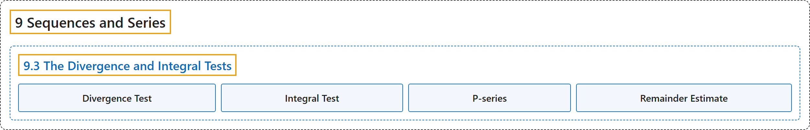

# 9.3 The Divergence and Integral Tests

## Classification

## Glossary

| Term | Definition | 中文翻译 | Source |
|---|---|---|---|
| **9 Sequences and Series** 数列与级数 | (No definition) | （无定义） | [Strang & Herman, 2016b, chapter 5](https://openstax.org/books/calculus-volume-2/pages/5-introduction) |
| **9.3 The Divergence and Integral Tests** 发散检验与积分检验 | (No definition) | （无定义） | [Strang & Herman, 2016b, section 5.3](https://openstax.org/books/calculus-volume-2/pages/5-3-the-divergence-and-integral-tests) |
| **Divergence Test** 发散检验 | "if $\lim_{n\to \infty }a_{n}\ne 0,$ then the series $\sum_{n=1}^{\infty }a_{n}$ **diverges**" | 若 $\lim_{n\to \infty }a_{n}\ne 0,$ 则级数 $\sum_{n=1}^{\infty }a_{n}$ **发散** | [Strang & Herman, 2016b, chapter 5 Key Terms](https://openstax.org/books/calculus-volume-2/pages/5-key-terms#fs-id1169738154867) |
| **Integral Test** 积分检验 | "for a series $\sum_{n=1}^{\infty }a_{n}$ with positive terms $a_{n},$ if there exists a continuous, decreasing function $f$ such that $f(n)=a_{n}$ for all positive integers $n,$ then $\sum_{n=1}^{\infty }a_{n}\text{and}{\int }_{1}^{\infty }f(x)dx$ **either both converge or both diverge**" | 对正项 $a_{n},$ 的级数 $\sum_{n=1}^{\infty }a_{n}$，若存在连续递减函数 $f$ 使得对所有正整数 $n,$ 有 $f(n)=a_{n}$，则 $\sum_{n=1}^{\infty }a_{n}\text{and}{\int }_{1}^{\infty }f(x)dx$ **要么都收敛，要么都发散** | [Strang & Herman, 2016b, chapter 5 Key Terms](https://openstax.org/books/calculus-volume-2/pages/5-key-terms#fs-id1169738154932) |
| **P-series** p 级数 | "**a series of the form** $\sum_{n=1}^{\infty }1/n^{p}$" | **形如 $\sum_{n=1}^{\infty }1/n^{p}$ 的级数** | [Strang & Herman, 2016b, chapter 5 Key Terms](https://openstax.org/books/calculus-volume-2/pages/5-key-terms#fs-id1169737433691) |
| **Remainder Estimate** 余项估计 | "for a series $\sum_{n=1}^{\infty }a_{n}$ with positive terms $a_{n}$ and a continuous, decreasing function $f$ such that $f(n)=a_{n}$ for all positive integers $n,$ the remainder $R_{N}=\sum_{n=1}^{\infty }a_{n}-\sum_{n=1}^{N}a_{n}$ **satisfies the following estimate**: ${\int }_{N+1}^{\infty }f(x)dx<R_{N}<{\int }_{N}^{\infty }f(x)dx$" | 对正项 $a_{n}$ 的级数 $\sum_{n=1}^{\infty }a_{n}$，以及对所有正整数 $n,$ 满足 $f(n)=a_{n}$ 的连续递减函数 $f$，余项 $R_{N}=\sum_{n=1}^{\infty }a_{n}-\sum_{n=1}^{N}a_{n}$ **满足以下估计**：${\int }_{N+1}^{\infty }f(x)dx<R_{N}<{\int }_{N}^{\infty }f(x)dx$ | [Strang & Herman, 2016b, chapter 5 Key Terms](https://openstax.org/books/calculus-volume-2/pages/5-key-terms#fs-id1169737174578) |

## References

Strang, G., & Herman, E. (2016b). *Calculus volume 2*. OpenStax. Retrieved October 29, 2026, from <https://openstax.org/details/books/calculus-volume-2>
