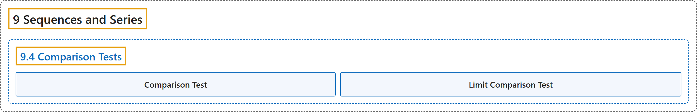

# 9.4 Comparison Tests

## Classification

## Glossary

| Term | Definition | 中文翻译 | Source |
|---|---|---|---|
| **9 Sequences and Series** 数列与级数 | (No definition) | （无定义） | [Strang & Herman, 2016b, chapter 5](https://openstax.org/books/calculus-volume-2/pages/5-introduction) |
| **9.4 Comparison Tests** 比较检验 | (No definition) | （无定义） | [Strang & Herman, 2016b, section 5.4](https://openstax.org/books/calculus-volume-2/pages/5-4-comparison-tests) |
| **Comparison Test** 比较检验 | "if $0\le a_{n}\le b_{n}$ for all $n\ge N$ and $\sum_{n=1}^{\infty }b_{n}$ **converges**, then $\sum_{n=1}^{\infty }a_{n}$ converges; if $a_{n}\ge b_{n}\ge 0$ for all $n\ge N$ and $\sum_{n=1}^{\infty }b_{n}$ **diverges**, then $\sum_{n=1}^{\infty }a_{n}$ diverges" | 若对所有 $n\ge N$ 有 $0\le a_{n}\le b_{n}$ 且 $\sum_{n=1}^{\infty }b_{n}$ 收敛，则 $\sum_{n=1}^{\infty }a_{n}$ **收敛**；若对所有 $n\ge N$ 有 $a_{n}\ge b_{n}\ge 0$ 且 $\sum_{n=1}^{\infty }b_{n}$ 发散，则 $\sum_{n=1}^{\infty }a_{n}$ **发散** | [Strang & Herman, 2016b, chapter 5 Key Terms](https://openstax.org/books/calculus-volume-2/pages/5-key-terms#fs-id1169736778029) |
| **Limit Comparison Test** 极限比较检验 | "suppose $a_{n},\,b_{n}\ge 0$ for all $n\ge 1.$ If $\lim_{n\to \infty }a_{n}/b_{n}\to L\ne 0,$ then $\sum_{n=1}^{\infty }a_{n}$ and $\sum_{n=1}^{\infty }b_{n}$ **both converge or both diverge**; if $\lim_{n\to \infty }a_{n}/b_{n}\to 0$ and $\sum_{n=1}^{\infty }b_{n}$ converges, then $\sum_{n=1}^{\infty }a_{n}$ converges. If $\lim_{n\to \infty }a_{n}/b_{n}\to \infty ,$ and $\sum_{n=1}^{\infty }b_{n}$ diverges, then $\sum_{n=1}^{\infty }a_{n}$ diverges" | 设对所有 $n\ge 1.$ 有 $a_{n},\,b_{n}\ge 0$。若 $\lim_{n\to \infty }a_{n}/b_{n}\to L\ne 0,$ 则 $\sum_{n=1}^{\infty }a_{n}$ 和 $\sum_{n=1}^{\infty }b_{n}$ **都收敛或都发散**；若 $\lim_{n\to \infty }a_{n}/b_{n}\to 0$ 且 $\sum_{n=1}^{\infty }b_{n}$ 收敛，则 $\sum_{n=1}^{\infty }a_{n}$ 收敛。若 $\lim_{n\to \infty }a_{n}/b_{n}\to \infty ,$ 且 $\sum_{n=1}^{\infty }b_{n}$ 发散，则 $\sum_{n=1}^{\infty }a_{n}$ 发散 | [Strang & Herman, 2016b, chapter 5 Key Terms](https://openstax.org/books/calculus-volume-2/pages/5-key-terms#fs-id1169736592441) |

## References

Strang, G., & Herman, E. (2016b). *Calculus volume 2*. OpenStax. Retrieved October 29, 2026, from <https://openstax.org/details/books/calculus-volume-2>
